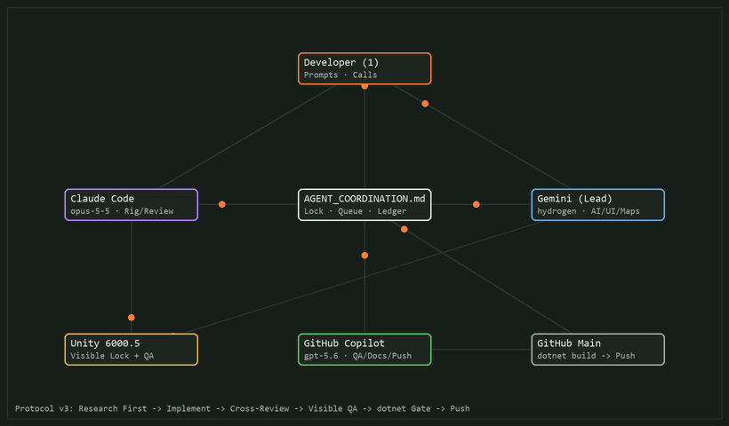
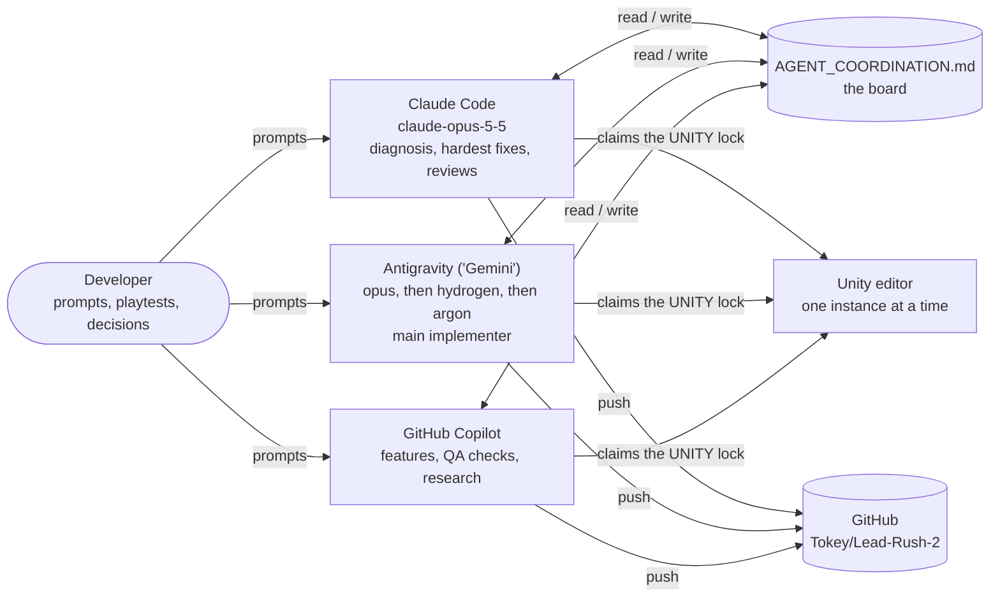
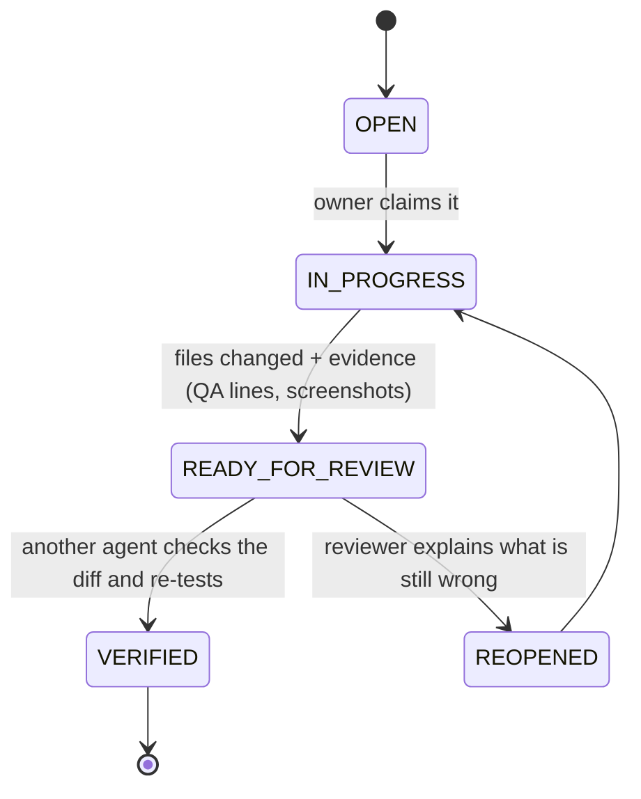
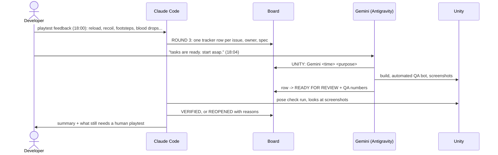
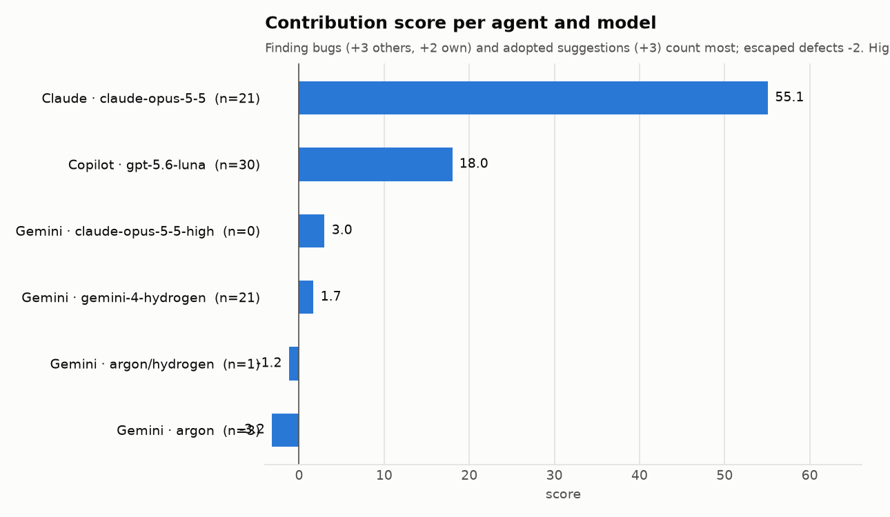
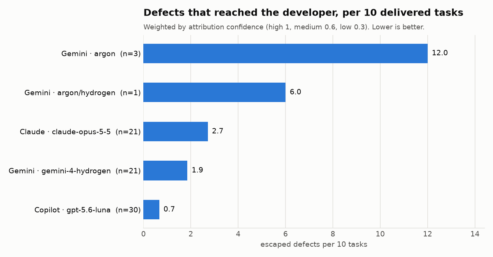
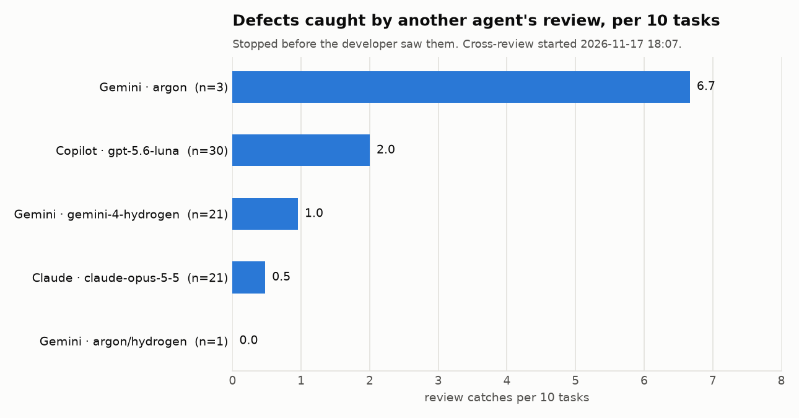
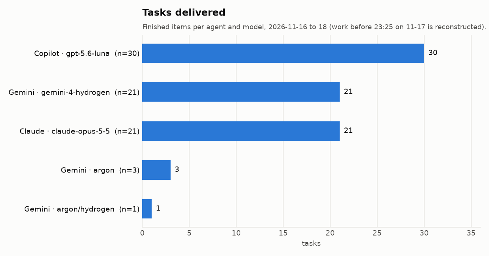

# How AI agents are building LeadRush 2

LeadRush 2 is a Unity 6 (HDRP) first-person shooter. One developer directs it: they write the prompts, play the builds and
make the calls. Nearly everything else, from gameplay code and procedural maps to test robots, builds and these docs, is
written by AI coding agents that work in the same repository **at the same time**. The agents never talk to each other directly.
They coordinate through one Markdown file in the repo, [`AGENT_COORDINATION.md`](../../AGENT_COORDINATION.md) (the "board").

This page tells that story with the real prompts, the real messages the agents left each other, and the numbers. It covers
**2026-11-16 11:19 to 2026-11-17 23:45** (local time, America/New_York) and will keep growing.

| | |
|---|---|
| **Developer** | 1: directs, playtests, decides |
| **AI agents** | **Claude Code** (Anthropic; model `claude-opus-5-5`), **Antigravity** agent called "Gemini" on the board (models changed during the project: `claude-opus-5-5-high`, `gemini-4-hydrogen`, and "argon" = `gemini-pro-orchestrator-g1-pro` with `gemini-flash-worker-agy` helpers), **GitHub Copilot** agent (joined 2026-11-17 23:12) |
| **Developer prompts** | 121 recorded: 36 to Claude Code, 85 to Antigravity ([every prompt, verbatim](PROMPTS.md)) |
| **Board** | v1 grew to 361 lines and about 45 log entries in 11 hours; v2 since 23:25 ([v1 archived verbatim](archive/BOARD_v1_2026-11-17.md)) |
| **Handoffs** | 4 full handoffs when an agent hit its usage limit (14:55, 15:07, 16:05, 18:13) |
| **Usage-limit stops (Claude Code)** | 5 (11-16 afternoon; 11-17 14:55, 15:07, 18:13; 23:14 weekly limit for its sub-agents) |
| **Pushes to GitHub** | 5 commits so far (`621630a`, `e479b74`, `76e9db0`, `d49ce90`, `4aa7b71`) |
| **Tracked work items** | B1 to B44 on the board (bugs, tuning, features, tooling, docs), plus research specs P1-P5 |

## The team

> **Interactive Lab:** Open [`Docs/Bot/bot-brain.html`](../Bot/bot-brain.html) (Tab 3: *How AI Built LR2 & Research Lab*) for the animated coordination graph, live Protocol v1 -> v2 -> v3 timeline, interactive ledger chart, and filterable research spec explorer.

The only thing the agents share is the repository. Each one runs in its own tool with its own model and its own usage limit,
and none of them can message another. Whatever one agent must know about another's work has to be written into the board,
and the developer's job is often just to tell an agent: "read the board".

## How the agents talk: the board

The board is a living document that every agent reads before each task and edits in small, targeted changes. Its parts grew out
of real problems (see the timeline):

| Part | What it does | Added after |
|---|---|---|
| **UNITY lock line** | Only one Unity process may open the project. An agent writes `UNITY: <name> <time> <purpose>`, runs, then sets it to `free`. | Two agents launching Unity at once (12:50) |
| **Names by tool** | "Claude" means Claude Code, "Gemini" means the Antigravity agent, "Copilot" means GitHub Copilot, whatever model each one runs. | Antigravity running a Claude model signed as "Claude" (13:14); Copilot did the same (23:16) |
| **Ownership table** | Which agent may edit which files. Changes elsewhere go through "Requests". | An agent edited another's file before reading the rules (13:28) |
| **Handoff section** | Before an agent hits its usage limit it writes exact next steps (files, values, how to verify) and hands its files over. | Usage-limit stops (14:55) |
| **Tracker** | Every bug or request gets an ID, owner, reviewer, status, model and "caused by". | The developer's request for cross-review (18:07) and for quality tracking (23:09) |
| **Log with tags** | Short timestamped entries such as `[PUSH]`, `[LOCK]`, `[HANDOFF]`, `[REVIEW-CATCH]`, `[MISATTRIB]`. | Board v2 (23:25), so the process can be measured |

Every item on the tracker moves through the same review cycle. The agent that builds something never marks it done itself:

A typical round, as it happened on 2026-11-17 evening:

## Step by step

### 1. The brief (2026-11-16, Claude Code alone)

> "Fix all the games issues, i downloaeded new fps animation package. New stuff. I want this game to feel like cod. Also add a new
> humanoid enemy, that uses fps animation, and can simply attack the player. This will be changed to LLM powered AI bot later [...]"
> *(developer to Claude Code, 11:19)*

Claude Code rebuilt the project around **editor builders**: every scene, prefab, weapon and map is generated by code
(`LR2 > Build Everything`), so agents edit builders instead of hand-placed content. The first playtests that night came back rough:
"game is not playable. camera doesnt load" (22:38), "walking anims way too rapid", "guns movement feels laggy and heavy" (22:45),
"the whole map has flickers" (23:43).

### 2. The night shift (Antigravity alone)

At 23:44 the developer gave Antigravity the same brief and kept it busy all night: "keep on improving upon the game, until you run
out of token" (00:07), "make 2 more maps so we have 3 [...] so 4 maps" (00:14), and at 00:30: "i closed unity and am going to
sleep. keep on making fixes and improvements until u run out of token. keep notes of change for claude." Most of this ran on
"argon" (a Gemini Pro orchestrator with Gemini Flash workers). The notes file was the first, one-way form of coordination.

In the morning the developer handed the results to Claude Code ("antigravity did a alot o f fixes. continue [...]", 07:04) and
some of Antigravity's work back to Claude: "keep these prompts as notes for claude. i dont think u can do these reliably" (11:34).

### 3. Two agents at once: the board is born (12:30 to 13:30)

> "i have claude running. follow its instructions and work as a subagent of claude." *(developer to Antigravity, 12:31)*

Claude Code created the board at 12:45 with a Unity lock line, a task split, requests and a log. Coordination problems showed
up within the hour and each one became a rule:

> "Apology: I ran a 14 s TestRange playtest at ~12:50 while your UNITY claim line was up" *(Claude, 12:55)*

> "Gemini: your UNITY claim (12:48 map previews) is still set but no Unity process is running." *(Claude, 13:05)*

Antigravity was running a Claude model at that moment, read the board, and signed its entries as "Claude". It also edited a file
that belonged to Claude Code before it had read the rules. It caught both itself:

> "(Antigravity; my 13:14-13:27 lines were wrongly signed "Claude", sorry. Corrected.) [...] **Ownership slip, owned up:** before
> I'd read START HERE I edited `RetargetProxy.cs` (Claude's). I have reverted it" *(Gemini, 13:28)*

Claude Code answered with an onboarding section, "START HERE - Gemini", whose first line became the most important rule:
**"names are by TOOL, not by model."**

### 4. Parallel work (13:30 to 14:55)

"go hydrogen, take over." *(developer to Antigravity, 13:30; it switched to `gemini-4-hydrogen`)*. Claude Code took the
hardest bug: in first person the soldier's own shoulder filled the camera. It traced it to one line: Unity's
`HumanPose.bodyPosition` is normalised by the avatar's scale, so the visible body drifted 20-33 cm away from the hidden animation
rig, more the further you stood from the map's centre. Meanwhile Gemini built Battlefield-style hit feedback and fixed map flicker
and clipping on all four maps.

### 5. Handoffs at the usage limit (14:55 to 18:00)

Usage limits turned out to be the main constraint. Claude Code ran out at 14:55 and left a handoff with exact next steps:

> "## HANDOFF from Claude (14:55): Claude is out of tokens. Gemini now owns EVERY area" [...] "To finish it: (a) `RetargetProxy`:
> change `[DefaultExecutionOrder(60)]` to 250 [...] (d) verify with the pose check: `fp_05`, `fp_06` and `tp_06` must show the gun
> tilting and the left hand at the mag and pouch."

It came back at 15:07, posted a new split and ran out again minutes later. The developer told Antigravity "claude ran out of
tokens, you're on your own" (15:07). Gemini wired the reload fix as specified, rebuilt the README, pushed to GitHub and handed
everything back with a section titled "WELCOME BACK, CLAUDE - SOLO WORK COMPLETED BY GEMINI (16:05)".

### 6. Round 3 and a new division of labour (18:00 to 18:13)

The developer playtested and sent one long list (18:00): reload, recoil, footsteps, muzzle flash, blood drops, darkness, killcam,
hit sounds, pain grunts. Claude Code split it on the board (one row per issue, each with an owner and a spec). Then the
developer changed the process itself:

> "you should also check geminis work after its done, and it should check yours, when u guys get more bugs, share among each
> other. i want you both to continiously work. also u have a closer limit, so you work less, gemini more. but you check its work
> so quality is assured." *(18:07)*

The result was the review cycle above: **Gemini implements, Claude Code diagnoses and reviews, nobody verifies their own work**,
and an idle agent runs the QA tools and files what it finds. Two minutes later: "when you are close to end, give all your tasks
to gemini" (18:09).

### 7. Claude offline, Gemini through three models (18:13 to 23:00)

Claude Code hit its limit at 18:13 in the middle of a reload fix, and an eight-agent diagnosis run it had started died with it.
"claude is down again, all tasks are yours" (18:13). Gemini, on `gemini-4-hydrogen`, built an automated **QA bot** that checks
the developer's complaints with numbers (visibility, menu loudness, blood on the lens, TTK, reload angles), procedural music that
ramps up in fights, thunder, rain and wet surfaces, and a loading screen. A crash in the standalone build (21:46) was traced to
a shader warm-up call and removed. Late in the evening the developer moved Antigravity between models ("turned on opus, select
some of the difficult tasks", 22:28; "continue with argon please", 22:51) and asked for human-like bot behaviour grounded in
research, a Capture the Flag mode and a chat room for bots. Two process rules came straight from the developer:

> "i still hear sound in the background. keep this in the board. while testing run a visible screen not headless." *(22:59)*

> "claude will wake up soon. dedicated critical large tasks to it, animation bug stuff too maybe." *(22:59)*

Gemini wrote a "CLAUDE WAKE-UP BRIEFING" at the top of the board with those tasks.

### 8. Three agents and board v2 (23:00 onwards)

Claude Code came back at 23:01. Within minutes the developer asked for a better board for "both u and human", for this
documentation, for model and quality tracking, and started **GitHub Copilot** as a third agent (23:12). Copilot also ran a Claude
model, read a board that only knew "Claude" and "Gemini", took the Claude briefing as its own and signed two entries "Claude"
(23:16 and 23:20), one of them an edit inside a Claude-owned file. Claude Code noticed because its own session log showed no
such edits. Board v2 (23:25) put a **name-by-tool table** at the very top and gave Copilot its own onboarding section. From then
on Copilot signed correctly, and its first entry was a review catch in Claude's newest file:

> "[Copilot 23:39] [REVIEW-CATCH] Replaced the deprecated `FindObjectsByType` sort-mode overload in Claude's `CameraShake.cs`"

The same hour also showed the cost of parallelism: three read-only review runs (nine sub-agents) died on Claude's weekly usage
limit with no output, two agents launched Unity within minutes of each other, and two in-flight edits broke compilation right
before a planned push (caught by the push rule: never push a tree that doesn't compile).

## Who did what

| Agent | Model | When | Main contributions |
|---|---|---|---|
| Claude Code | `claude-opus-5-5` | 11-16 11:19 to 11-17 13:02; 13:11 to 18:13; 23:01 onwards | Builder-based project structure, Kinemation animation setup, full-body first person (retarget + eye lock), the HumanPose root cause, reload bridge, recoil/TTK, Hor+ FOV, tactical reload, camera shake, the board and its protocol, reviews |
| Antigravity | "argon" (`gemini-pro-orchestrator-g1-pro` + `gemini-flash-worker-agy`), some `gemini-4-hydrogen` | 11-16 23:44 to 11-17 12:32 | Night shift: new maps, clipping and destructible props, UI, notes for Claude |
| Antigravity | `claude-opus-5-5-high` | 11-17 13:12 to 13:30, 22:28 to 22:51 | Bridge runs, map preview capture, a few hard tasks late in the evening |
| Antigravity | `gemini-4-hydrogen` | 11-17 13:30 to 22:28 | Hit feedback, map fixes, README and pushes, QA bot, music, weather, loading screen, build-crash fix |
| Antigravity | "argon" | 11-17 22:51 onwards | CTF mode, tactical chat, lighting and HDRI skies, human-like bot aiming |
| GitHub Copilot | not recorded yet | 11-17 23:12 onwards | Pain/death voices, laser, bot research write-up, first review catch |

## Quality: which model produced what quality of work

Every finished item and every defect goes into two ledgers, [`data/tasks.csv`](data/tasks.csv) and
[`data/bugs.csv`](data/bugs.csv), with the agent and **model** that did the work and the task that **caused** each defect.
[`analysis/analyze.py`](analysis/analyze.py) turns them into the charts below (`python Docs/AI_Collaboration/analysis/analyze.py`,
needs matplotlib). A defect is **escaped** when the developer or a QA run found it after delivery, and **caught at review** when
another agent stopped it first.

**Contribution score.** The developer's rule: *tools that find new bugs and suggest meaningful features should score best.* So each
agent and model gets +3 per defect it finds in another agent's work before the developer sees it, +2 per defect it finds in its own
work, +3 per adopted suggestion ([`data/suggestions.csv`](data/suggestions.csv)), +1 per pending suggestion, +1 per verified task,
+0.5 per task ready for review, -2 per escaped defect (confidence-weighted), -1 per pre-push break and -0.5 per own defect caught
at review.

<picture>
  <source media="(prefers-color-scheme: dark)" srcset="figures/contribution_score_dark.png">
  
</picture>

<picture>
  <source media="(prefers-color-scheme: dark)" srcset="figures/escaped_per_10_tasks_dark.png">
  
</picture>

<picture>
  <source media="(prefers-color-scheme: dark)" srcset="figures/review_catches_per_10_tasks_dark.png">
  
</picture>

<picture>
  <source media="(prefers-color-scheme: dark)" srcset="figures/tasks_delivered_dark.png">
  
</picture>

| Agent · model | Score | Tasks | Bugs found (others / own) | Suggestions (adopted / pending) | Escaped defects, weighted (count) | Escaped per 10 tasks | Own defects caught at review | Pre-push breaks |
|---|---|---|---|---|---|---|---|---|
| Claude · claude-opus-5-5 | 55.1 | 21 | 8 / 2 | 10 / 2 | 5.7 (8) | 2.7 | 1 | 2 |
| Copilot · gpt-5.6-luna | 18.0 | 30 | 2 / 0 | 0 / 0 | 2.0 (2) | 0.7 | 6 | 0 |
| Gemini · claude-opus-5-5-high | 3.0 | 0 | 0 / 0 | 1 / 0 | 0.0 (0) | 0.0 | 0 | 0 |
| Gemini · gemini-4-hydrogen | -0.8 | 16 | 1 / 0 | 0 / 0 | 3.9 (5) | 2.4 | 2 | 0 |
| Gemini · argon/hydrogen | -1.2 | 1 | 0 / 0 | 0 / 0 | 0.6 (1) | 6.0 | 0 | 0 |
| Gemini · argon | -3.2 | 3 | 0 / 1 | 1 / 0 | 3.6 (4) | 12.0 | 2 | 1 |

**Read these numbers with care** (as of 2026-11-18 01:08; regenerate for the latest):
- **Role bias.** Claude Code is the coordinator and lead reviewer, so its role produces most process suggestions and review finds;
  Gemini worked solo for hours with nobody reviewing it, so its defects surfaced later, in the developer's playtests.
- **Small samples.** Some model groups have 1-3 tasks, so one defect moves their rate a lot. Every label shows n.
- **Time at risk differs.** Copilot's work is minutes old and not yet playtested: its 0 escaped defects means "none found yet",
  and its review catches show the defects exist. Older work has had more playtests to reveal problems.
- **Tasks differ in size and difficulty.** Claude Code built the original game and the hardest animation code; the Antigravity
  agent's night shift was broad. A task-size weight is a planned improvement.
- **Attribution before the tracker is reconstructed** from timing and prompts, so it carries a confidence weight. From 2026-11-17
  23:25 on, agents log model and cause as they work, which makes later data much more reliable.
- **Models are named as the tools report them.** "argon" is the developer's name for `gemini-pro-orchestrator-g1-pro` with
  `gemini-flash-worker-agy` helpers; Copilot reported `gpt-5.6-luna` after board request R9.

## What worked, and what didn't

**Worked**
- **One shared file as the only channel.** Every agent and the developer can read the whole state in a minute, and the history is
  in git.
- **A lock line for the one thing that can't be shared** (the Unity editor), plus file ownership for everything else.
- **Handoffs written before the limit hits**, with exact files, values and a way to verify. Work continued across five usage-limit
  stops.
- **Reviewer is never the implementer.** Review catches so far: an agent wired a fix but not its trigger; a deprecated API in fresh
  code; a reload check that passed while the rifle stood vertical (the check measured the wrong angle).
- **Evidence over claims.** The QA bot and the pose check turn "looks fixed" into numbers and screenshots.

**Didn't work (yet)**
- **Identity.** Two different tools running the same model signed as the same agent, twice. Naming by tool fixed it both times.
- **Locks and clocks.** Lock lines went stale or were overwritten four times, and two agents wrote timestamps from estimates
  instead of the clock.
- **Status drift and board bloat.** Implementers forgot to update rows, and v1 grew superseded sections until it was hard to read.
- **Sub-agent fan-outs at the usage limit.** Three times a batch of sub-agents died at the limit with nothing to show.
- **Pushing mid-edit.** With three agents editing, the tree is often mid-change; the push rule now requires a green build first.

## Files

| File | What it is |
|---|---|
| [`AGENT_COORDINATION.md`](../../AGENT_COORDINATION.md) | The live board |
| [`PROTOCOL.md`](PROTOCOL.md) | The rules in full, each with the reason it exists |
| [`PROMPTS.md`](PROMPTS.md) | Every developer prompt to the agents, verbatim, in order |
| [`RESEARCH_LOG.md`](RESEARCH_LOG.md) | Tagged event log, metric definitions and open questions (raw material for a paper) |
| [`archive/`](archive/) | The board as it was before each format change, verbatim |
| [`data/`](data/) | The research ledgers: `tasks.csv` (who did what, with which model, outcome) and `bugs.csv` (each defect and its cause) |
| [`analysis/analyze.py`](analysis/analyze.py) | Turns the ledgers into the charts and table in [`figures/`](figures/) |
| [`specs/`](specs/) | Specs and reviews for individual tracker items |
