# LR2 Bot Brain — Complete Technical & Empirical Field Manual

This repository page mirrors and expands the interactive [LR2 Bot Brain artifact](https://claude.ai/artifact/NrTa76HJCAAFzydVUuD2Zo). The interactive multi-tab HTML version lives in [`Docs/Bot/bot-brain.html`](Bot/bot-brain.html), and all companion 1:1 canvas GIFs below are deterministically rendered by `python Tools/make_bot_gifs.py`.

---

## Live Field Demo · Watch a Bot Play

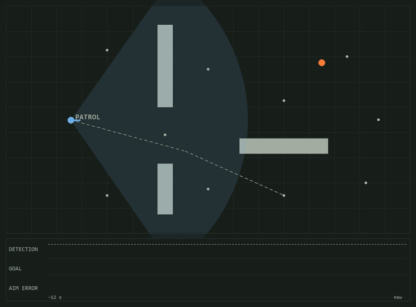

Top-down arena (`32×18 m`) paired with the live 12-second **Detection / Goal / Aim Error** timeline strip. The bot (blue) patrols weighted tactical waypoints, redirects to investigate gunshots, fills its continuous visibility meter, executes a Fitts-law minimum-jerk flick, fires controlled bursts, flanks an anchored camper, and hunts `targetLastKnown` while corner-slicing.

---

## Bot Lab scenarios

Each GIF is captured from the interactive **[LR2 Bot Lab](Bot/bot-lab.html)** (source of the [Claude artifact](https://claude.ai/artifact/Mj3oVBaf6NpdgRJSsxicPo)),
which runs a compact copy of the bot brain: detection meter, the goal ladder every 0.25 s, reaction time, Fitts flicks with a
minimum-jerk path, 125 ms lag on your velocity, bursts and recoil heat. The player (orange) follows a script; the bot (blue) does
not. Regenerate with `python Tools/make_bot_lab_gifs.py` (headless Edge renders the page itself, so the GIFs match the artifact).

| Spot and duel | Counter-strafe |
|---|---|
| 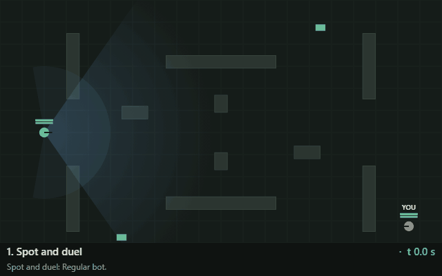 | 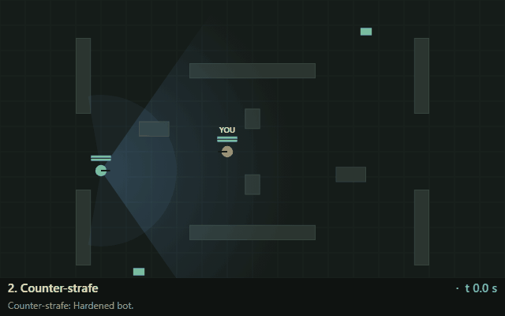 |
| You walk into view. The detection meter fills (0.9 + 9/distance per second, faster when you move), then a human reaction time, then bursts with a settling aim error. | You strafe left and right. The bot reads your sideways speed 125 ms late, so its misses land behind you after each direction change. |

| Break line of sight | Flank a camper |
|---|---|
| 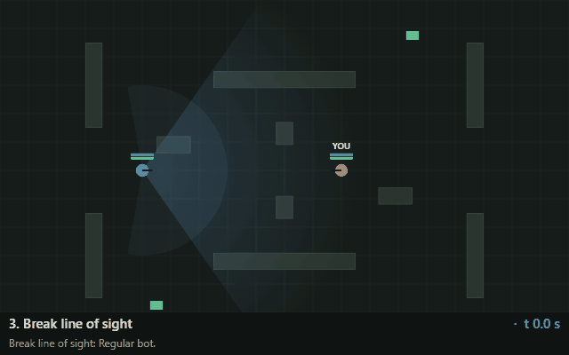 | 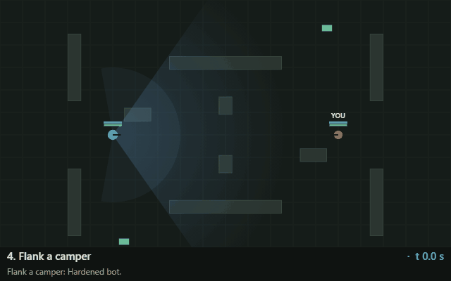 |
| You fire and hide behind a wall. It hunts your last known position, finds it empty, checks where the shots came from; you get the first shot. | You hold an angle. After 6 s of you anchored in place it passes its flank roll, leaves the lane and comes in from the side you are not watching. |

| Retreat and heal | Armour break and resupply |
|---|---|
| 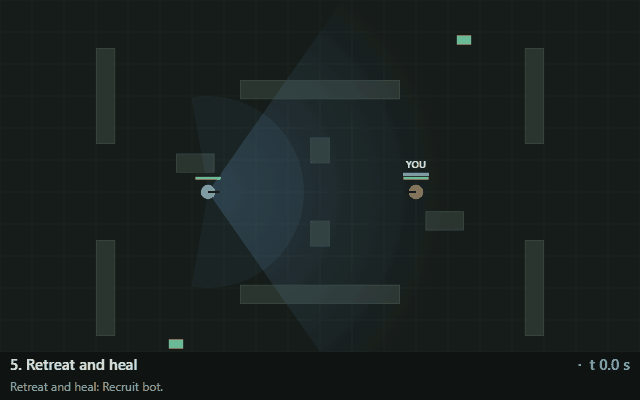 |  |
| Below 38 % health under fire it breaks off to cover, waits out the 4 s regen delay, heals past 85 % and hunts you again. | Its armour breaks and you leave. Hunting outranks resupply, so it checks your last position first, then walks to the nearest ready ammo station (+50 armour, +120 rounds; the station goes dark for 20 s). |

| Investigate a shot | Contest the flag |
|---|---|
| 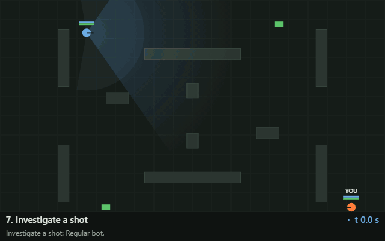 | 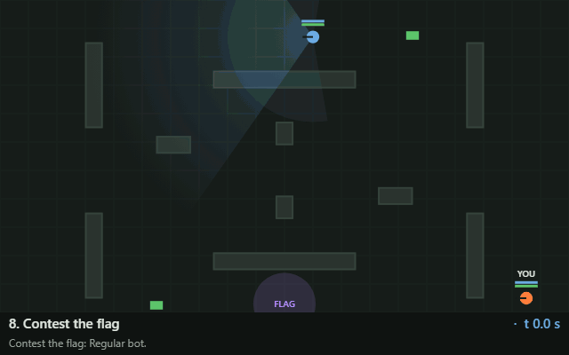 |
| You fire out of sight 29 m away. It sprints to a fuzzy guess of the position (noises over 20 m away are sprinted to) and spots you on the way. | Capture the Flag: you start capturing. Stopping a capture outranks everything but survival and orders, so it drops its patrol and sprints to contest. |

## 0. Six-Component Pipeline (`Assets/LR2/Runtime/AI/`)

| Component | Rate | Source File | Responsibility |
|---|---|---|---|
| **1. `BotPerception`** | `10 Hz` (`0.10 s`) | [`BotPerception.cs`](../Assets/LR2/Runtime/AI/BotPerception.cs) | Dual-ray head+chest LOS check, `±100°` (`200°` arc) close-range `<6 m` check, continuous detection meter (`1.00` spot threshold), hearing noise & squad callouts |
| **2. `BotBlackboard`** | Every frame | [`BotTypes.cs`](../Assets/LR2/Runtime/AI/BotTypes.cs) | Single state frame (`health01`, `ammo01`, `underFire`, `targetLastKnown`, `TimeSinceSeen`) + flat `ToJson(goal)` `Snapshot` for external LLMs |
| **3. `TacticalBotBrain`** | `~4 Hz` (`0.25 s`) | [`TacticalBotBrain.cs`](../Assets/LR2/Runtime/AI/TacticalBotBrain.cs) | **Layer 1**: Evaluates exact 10-step priority waterfall & scores `CoverPoint`, `TryPickFlank`, `PickPatrol`, `FlagZone` 8-slot positions |
| **4. `BotController`** | Every frame | [`BotController.cs`](../Assets/LR2/Runtime/AI/BotController.cs) | **Layer 2**: Decoupled `NavMeshAgent` (`updatePosition=false`), corner slicing (`corners[1]` `±28°`), ADAD strafe blend, Fitts flicks & ESTA/CSKnow empirical miss pattern |
| **5. `AdaptiveDifficultyTracker`** | Event + `0.75 s` | [`AdaptiveDifficultyTracker.cs`](../Assets/LR2/Runtime/AI/AdaptiveDifficultyTracker.cs) | Measures `PlayerAccuracy01 = hits / max(8, shots)`, headshots, crouch rate & rush tendency; scales `Skill01 ∈ [0.12, 0.96]` and anti-camp timer (`4.0–7.2 s`) |
| **6. `IBotDirectiveProvider` & `TacticalChatSystem`** | `1.5 s` poll / `[T]` chat | [`TacticalChatSystem.cs`](../Assets/LR2/Runtime/UI/TacticalChatSystem.cs) | External commander orders + player keyword parsing (`flank`, `hold`, `push`, `flag`) -> `BotDirective` |

---

## 1. Perception: Dual-Ray Vision & Detection Meter

`BotPerception` samples vision every `0.1 s` against `HeadPosition` OR `ChestPosition` using `LR2Layers.VisionMask`. Within `6 m`, targets inside **±100° half-angle** (`200°` total peripheral awareness arc) register even outside the main cone:

`fillRate = detectionSpeed * (0.9 + 9.0 / max(distance, 1.5))`

Multiplied by `1.35` if moving `> 2 m/s`, `2.2` for `1 s` after firing a shot, `1.4` inside `±12°` foveal center, and `0.7` if crouched. When occluded, the meter drains at `0.5 / s`, and memory forgets after `12 s`. Initial reaction latency scales from `0.76×` (pre-aimed foveal contact) to `1.58×` (`115°` peripheral ambush).

---

## 2. Decision Tree (`TacticalBotBrain.cs`)

`TacticalBotBrain.Think()` evaluates goals in exact source order (~4 Hz):

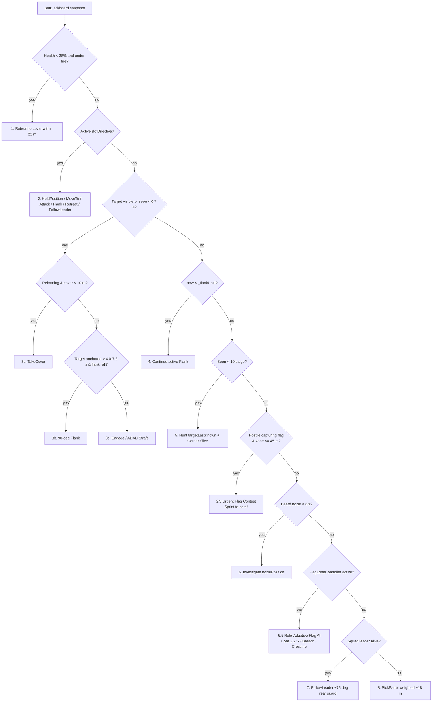

*(Note the verified source priority: **Step 2.5 Urgent Flag Contest** interrupts non-critical roaming when a hostile team is actively capturing within `45 m`, while **Step 6 Investigate noise** is checked BEFORE **Step 6.5 Role-Adaptive Flag AI** (`TacticalBotBrain.ObjectiveFlag`) — and inside the zone, `Engage()` clamps combat strafes so bots do not drift out of the capture ring.)*

---

## 3. Dual-Layer Pathfinding & Navigation

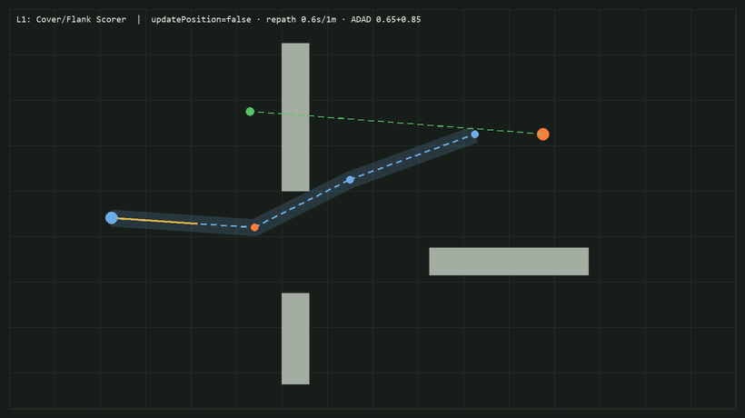

1. **Layer 1 (`TacticalBotBrain` @ 4 Hz — Spatial Utility):**
   - **`PickCover`:** Casts `Physics.Linecast` from `threatEye (+1.5 m)` to crouch (`0.9 m`) or standing (`1.5 m`) cover height and maximizes `-dist - 30 * (distToThreat < 6 m) + rng * 3`.
   - **`TryPickFlank`:** Scores `TacticalPoint` nodes `6–30 m` from the threat by `-|angle(-toTarget, fromTarget) - 90°| + weight * 10 + rng * 15`.
   - **`PickPatrol`:** Scores unvisited waypoints by `weight * 20 + min(60, sinceVisit) * 0.5 - |dist - 18 m| * 0.3 + rng * 12`.
2. **Layer 2 (`BotController` @ every frame — Decoupled `NavMeshAgent`):**
   - Runs `NavMeshAgent` with `updatePosition = false`, `updateRotation = false`, and `0.6 s` / `1 m` destination repath hysteresis.
   - Extracts `Agent.steeringTarget`, slices corners by orienting gaze toward `Agent.path.corners[1]` with `±28°` periodic tactical glances, blends combat ADAD strafing (`0.65 * route + 0.85 * right * strafeDir`), completes `OffMeshLinks`, and executes a `1.1 s` jump mantle / `2.4 s` `ResetPath()` stuck recovery.

---

## 4. Ballistic Flicks, Empirical Human Miss Pattern (B53) & Recoil

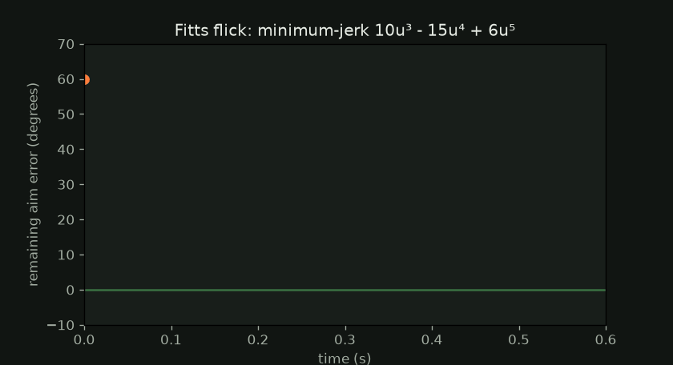

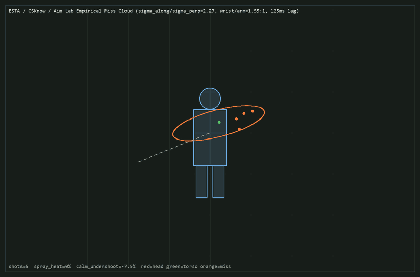

Grounded in **ESTA** (Xenopoulos & Silva 2022), **CSKnow** (Durst et al. 2022/2024), **Aim Lab** (Listman et al. 2021), **Meyer et al. (1988)**, **Harris & Wolpert (1998)**, and **van Beers et al. (2004)**:
- **Fitts + Minimum-Jerk Flicks (`> 10.5°`):** Duration `MT = clamp((65 ms + 42 ms · log2(1 + D/W)) · skillScale, 85 ms, 380 ms)`, exited when `u ≥ 1 || angularDist < 2.2°` with a `110–165 ms` post-flick visual refractory period.
- **Anisotropic Flick Covariance (`σ∥ / σ⊥ ≈ 2.27`):** Longitudinal scatter along the flick axis dominates orthogonal deviation, carrying a calm **`-7.5%` primary undershoot bias** that shifts toward `+3.5%` overshoot under high combat stress (`muAlong = Lerp(-0.075, +0.035, stress) * D`).
- **`1.55 : 1` Wrist-Yaw vs. Vertical-Arm Asymmetry:** Perlin tremor and Signal-Dependent Noise apply `1.15×` horizontal scaling vs. `0.74×` vertical scaling.
- **`125 ms` Visuomotor Target-Velocity Lag (`_perceivedTargetVel`):** Target velocity passes through a `dt / (0.125 + dt)` low-pass filter before computing `0.055 s` lead, creating authentic trailing-edge misses during counter-strafes (`ADAD`).
- **Delayed Recoil Compensation & Late-Spray Horizontal Weave:**

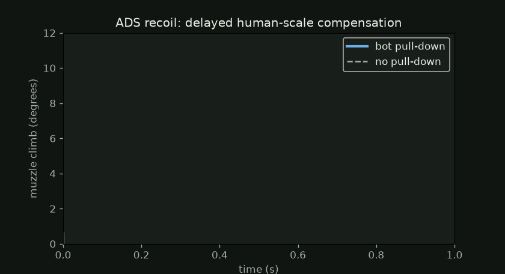

Pull-down starts after `65–135 ms`, fatigues with `sprayHeat` (`0.19/shot` hip, `0.13/shot` ADS), and adds bimanual horizontal oscillation when `sprayHeat > 0.25`. Trigger tolerance scales with target solid angle: `max(fireTolerance, atan2(0.45, dist))` — full-auto `< 13 m`, bursts `≥ 13 m`.

---

## 5. Adaptive Difficulty & Game Modes + CTF Zones + Tactical Chat

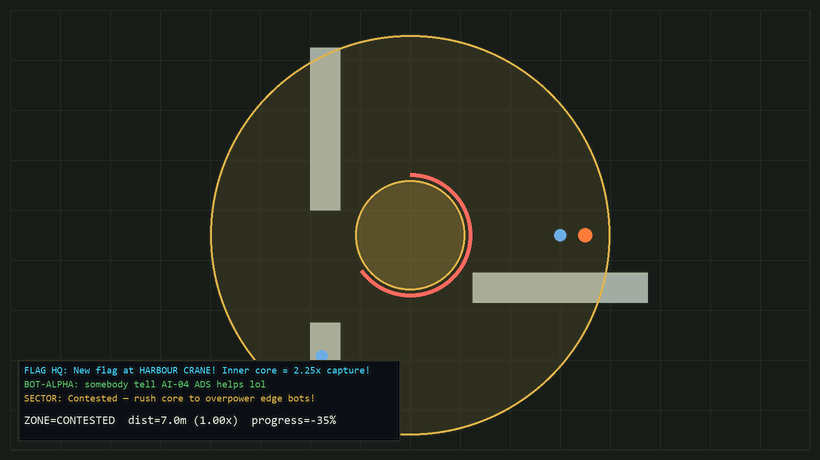

- **Game Modes (`MatchSettings.cs` / `MatchManager.cs`):** Supports **1v1 Duel**, **Free-For-All**, **Team Deathmatch**, and **Unified Rotating Capture the Flag (`B51`)** with a configurable **Bot Team Mode (`BotTeamMode`)** in Settings, Deploy, and Mode Rules (**Squads**, **Free-For-All**, **All Bots Same Team**, or **All Bots Player Team**). Bots receive **32 randomized funny gamertags** via Fisher-Yates shuffle (`B62`). Scoring: `+100` kill, `+50` headshot, `+25` assist, `+250` flag capture.
- **Smart Flag-Playing Bot AI (`FlagZoneController.cs` & `TacticalBotBrain.cs`, `B63`):** Zone rotates after capture or `55 s` idle timeout. Inside the `2.6 m` core, capture speed runs at **`2.25×`**, decaying smoothly out to **`0.28×`** at `11.5 m` (`Lerp(2.25, 0.28, t^0.65)`). Bots use `CountZoneOccupants` and `IsHostileCapturingOrContesting` for three smart tactical behaviors:
  1. **Step 2.5 Urgent Flag Contest:** When a hostile team is actively capturing or contesting within `45 m`, bots sprint straight into the `2.6 m` core to halt progress.
  2. **Step 6.5 Role-Adaptive Flag AI (`ObjectiveFlag`):** Bots split roles between **Contested Breach** (tight core push when contested/enemy-owned), **Core `2.25×` Anchor** (deterministic 8-slot golden ring inside `2.45 m` when ≤1 ally is on point), and **Perimeter Crossfire Overwatch** (`6.0 m–8.5 m` outer ring when 2+ allies already anchor the core).
  3. **In-Zone `Engage()` Clamp:** During gunfights inside the zone, combat strafe targets are clamped inside the `11.5 m` radius so bots never walk off the cap mid-duel.
- **Task Source Audit:** Full prompt/board origin for every task is tracked in [Docs/AI_Collaboration/figures/tasks_log.md](AI_Collaboration/figures/tasks_log.md).
- **Tactical Bot Chat (`TacticalChatSystem.cs`):** Queues kill roasts, headshot reactions, bot-vs-bot banter, and `FLAG HQ` sector alerts with `1.0–2.4 s` human typing latency, and parses `[T]` player keywords (`flank`, `hold`, `push`, `flag`) directly into `BotDirective` orders.

---

## 6. How AI Agents Build LeadRush 2 (`AGENT_COORDINATION.md`)

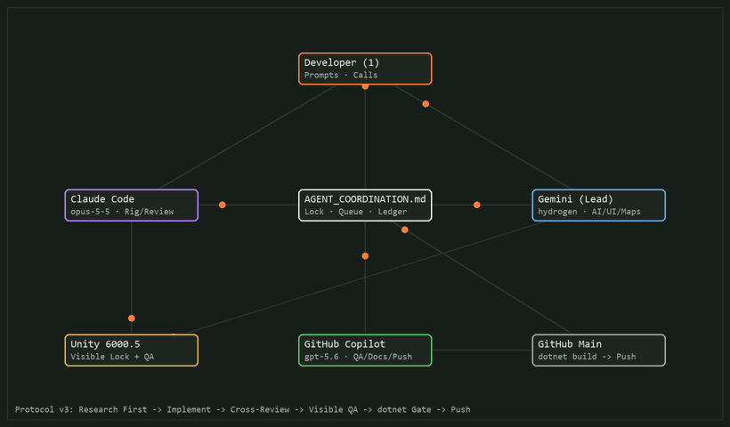

See the full documented multi-agent engineering story, model quality ledger charts, and research spec index in [`Docs/AI_Collaboration/README.md`](AI_Collaboration/README.md) and interactively inside Tab 3 of [`Docs/Bot/bot-brain.html`](Bot/bot-brain.html).

---

## Primary References

- Fitts, P. M. (1954). *J. Experimental Psychology* 47(6). · MacKenzie, I. S. (1992). *HCI* 7(1).
- Flash, T. & Hogan, N. (1985). *J. Neuroscience* 5(7). · Meyer, D. E. et al. (1988). *Psychol. Rev.* 95(3).
- Harris, C. M. & Wolpert, D. M. (1998). *Nature* 394. · van Beers, R. J. et al. (2004). *J. Neurophysiol.* 91(2).
- Xenopoulos, P. & Silva, C. (2022). *ESTA: An Esports Trajectory and Action Dataset*, arXiv:2209.09861.
- Durst, D. B. et al. (2022/2024). *CSKnow: Learning Human-Like Movement and Aiming from Match Telemetry*.
- Listman, J. B. et al. (2021). *PLOS ONE* 16(12): high-volume Aim Lab motor kinematics.
- Schrum, J., Karpov, I. V. & Miikkulainen, R. (2012). *Believable Bots*, Springer.
