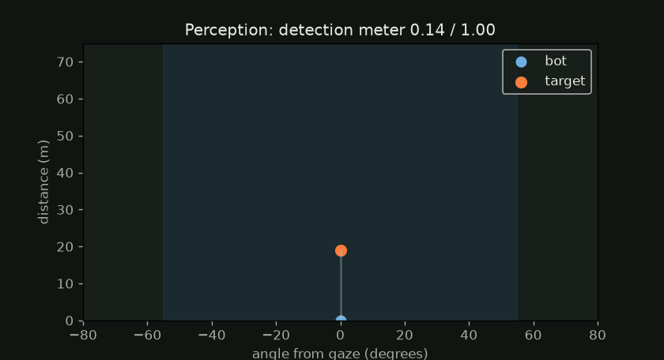
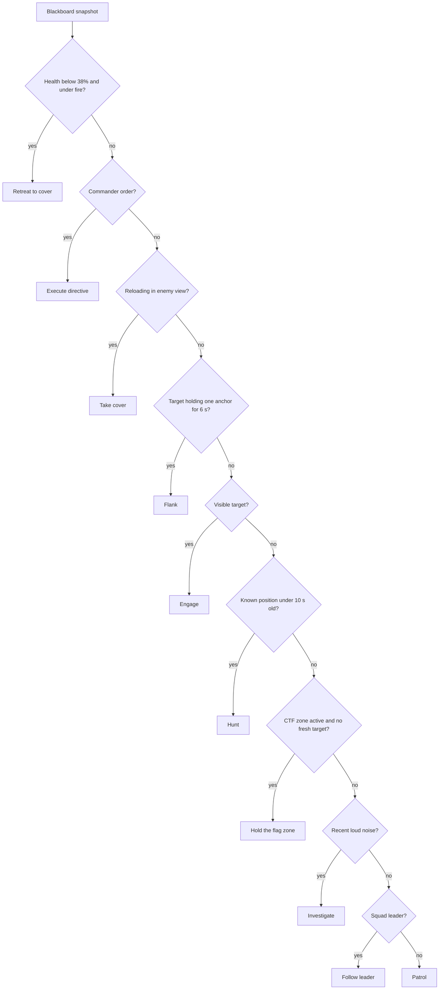
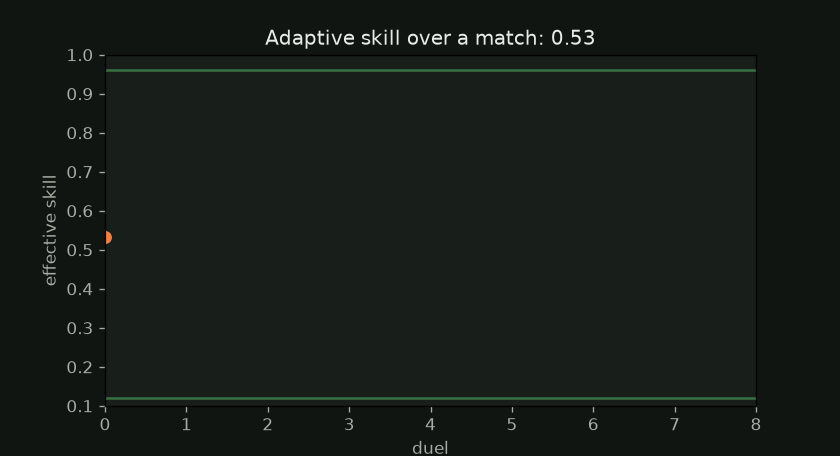

# LR2 Bot Brain

This is the GitHub mirror of the interactive
[LR2 Bot Brain artifact](https://claude.ai/artifact/NrTa76HJCAAFzydVUuD2Zo).
The repository copy is [`Docs/Bot/bot-brain.html`](Bot/bot-brain.html), and its
companion animations are generated by `python Tools/make_bot_gifs.py`.

## 1. Perception: seeing you

`BotPerception` samples vision every 0.1 s with randomized offsets. It checks
range, the active field of view, two body points, and the vision mask. Detection
fills continuously to 1.0, then decays at 0.5/s when sight is lost; memory expires
after 12 s. The fill rate is:

`detectionSpeed * (0.9 + 9 / distance)`

then multiplied by 1.35 for a target moving over 2 m/s, 2.2 for one second after
a loud shot, 1.4 within 12 degrees of the gaze, and 0.7 while crouched. Within
6 m, the special near-target check accepts a half-angle of **±100 degrees from
the gaze** (not 100 degrees total). Hearing adds distance-fuzzed threats, and
team callouts share partial detection after a 0.6 s delay.

## 2. Decision: choosing what to do

`TacticalBotBrain` thinks about four times per second and selects the first
eligible goal:

The order preserves counter-play: retreat and directives override attack,
reloading can expose a cover decision, and a stationary target eventually
causes a flank attempt. Difficulty assets supply the probabilities for cover,
flank, crouch and burst decisions.

## 3. Motor control: aiming like a hand

Large turns use Fitts's law:

`MT = (65 ms + 42 ms * log2(1 + D / W)) * skillScale`

with a clamp of 85-380 ms. The turn follows the minimum-jerk quintic
`10u^3 - 15u^4 + 6u^5`, then a damped spring tracks the target. Endpoint scatter
grows with turn size and combat stress; the turn rate is capped at 720 degrees/s.
The bot therefore cannot snap, teleport, or bypass the same soldier/recoil path
used by the player.

## 4. Recoil: delayed compensation

The bot inherits the weapon's recoil. Pull-down starts after a 65-135 ms reaction
delay, then uses a spring whose strength is:

`clamp(aimSpeed / 10.5, 0.55, 0.92) * (1 - 0.22 * sprayHeat)`

Heat rises by 0.19 per hip shot or 0.13 per ADS shot and cools at 0.95/s.
This intentionally leaves early spray shots high and preserves a human reaction
window.

## 5. Adaptive difficulty

Adaptive mode keeps a runtime skill value between 0.12 and 0.96. A win adds
0.045, an additional 0.03 on a streak, 0.02 for a headshot, and a small accuracy
bonus. A loss subtracts 0.040 and another 0.035 on a losing streak. The profile
refreshes every 0.75 s and maps skill to bounded reaction time, FOV, aim speed,
settled error, headshot chance, aggression, flank chance, crouch-peek rate and
burst size. Authored difficulty assets are never mutated.

## 6. Runtime and commander boundaries

The pipeline is:

`GameEvents -> BotPerception -> BotBlackboard -> TacticalBotBrain -> BotController -> SoldierController`

An `IBotDirectiveProvider` can issue strategic orders every 1.5 s. The supported
orders are `HoldPosition`, `MoveTo`, `Attack`, `Flank`, `Retreat`, and
`FollowLeader`. The low-level brain remains responsible for aim, pathing, cover
and fire discipline.

The commander receives only a compact blackboard summary: goal, health, ammo,
reload state, under-fire state, target visibility/distance/position and known
enemy count. It does not rotate the camera or apply frame-perfect aim. An
`IBotBrain` replacement can instead implement a custom `Think` loop, but it still
emits `BotIntent` through the normal controller. This keeps physics, hitboxes,
reloads, recoil and audio honest.

## 7. Sources and implementation

- Fitts, P. M. (1954), *The information capacity of the human motor system*,
  Journal of Experimental Psychology 47(6).
- MacKenzie, I. S. (1992), *Fitts' law as a research and design tool in HCI*,
  Human-Computer Interaction 7(1).
- Flash, T. & Hogan, N. (1985), *The coordination of arm movements*,
  Journal of Neuroscience 5(7).
- Meyer, D. E. et al. (1988), *Optimality in human motor performance*,
  Psychological Review 95(3).
- Harris, C. M. & Wolpert, D. M. (1998), *Signal-dependent noise determines
  motor planning*, Nature 394.
- Todorov, E. (2004), *Optimality principles in sensorimotor control*,
  Nature Neuroscience 7.
- Schrum, J., Karpov, I. V. & Miikkulainen, R. (2011/2012), *UT2:
  Human-like behavior via neuroevolution of combat behavior and replay of human traces*.

Runtime source of truth:
[`BotPerception.cs`](../Assets/LR2/Runtime/AI/BotPerception.cs),
[`TacticalBotBrain.cs`](../Assets/LR2/Runtime/AI/TacticalBotBrain.cs),
[`BotController.cs`](../Assets/LR2/Runtime/AI/BotController.cs), and
[`AdaptiveDifficultyTracker.cs`](../Assets/LR2/Runtime/AI/AdaptiveDifficultyTracker.cs).
