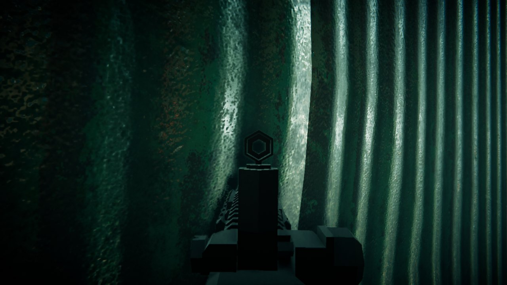
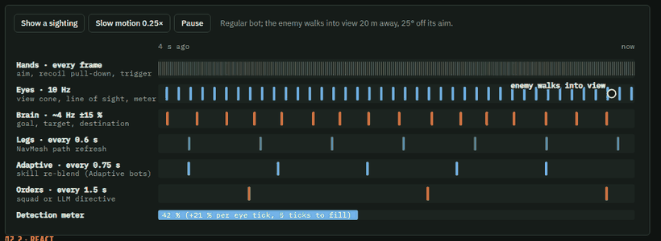
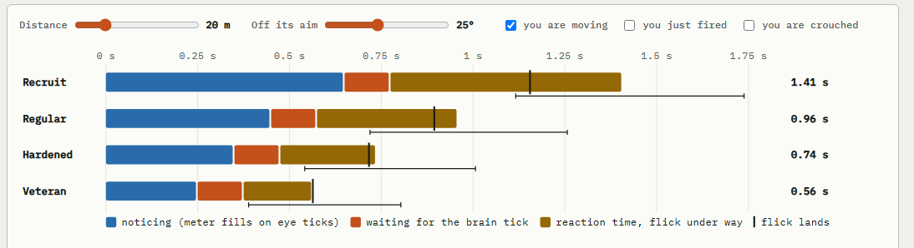
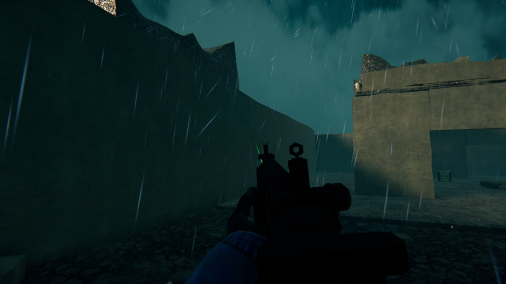

# LeadRush 2 - what's new on 2026-11-19 (builds 11.19.26.1 to 11.19.26.6, and the code pushed after them)

Everything below came from the developer's playtest notes of 11-18/11-19 and was built by Claude Code (`claude-opus-5-5`),
except the faster ADS, which Antigravity "Gemini" built before it went offline. Every item has a tracker row on
[`AGENT_COORDINATION.md`](../../AGENT_COORDINATION.md) and a ledger row in
[`Docs/AI_Collaboration/data`](../AI_Collaboration/data). The screenshots come from the automated first-person checks and
the Bot Lab page. Nothing is mocked up.

## Skirmish lobby and AI vs AI (B109)

The main menu is now a single **PLAY**. It opens a lobby in the style of Command & Conquer's skirmish screen:

| Part | What it does |
|---|---|
| **Roster** | You (or a spectator seat) plus up to **20 bots** in a scrolling list. Each bot has its own **difficulty** (Recruit, Regular, Hardened, Veteran, Adaptive) and **team** (free for all, Alpha, Bravo, Charlie, Delta), so 2, 3 and 4-way games all work. ADD BOT, BALANCE TEAMS, CLEAR, and ALL BOTS (sets every bot's difficulty at once). |
| **Presets** | 1V1, 2 TEAMS, 3-WAY, 4-WAY, FFA, AI VS AI. |
| **Match** | Mode, map with preview, score limit, time limit, respawn delay, seeker drones, your weapon; OPTIONS and ALL RULES (the full per-mode rules screen) as sub-menus. Everything is saved. |
| **AI vs AI** | No player soldier. A spectator camera follows the bots: chase, eye view or free fly, with an auto director that cuts to whoever just got a kill. The HUD shows the soldier you are watching. An **AI test bench** panel counts kills, deaths and K/D per difficulty, and bot names carry a difficulty tag, so you can see which setting wins. |
| **Scoring** | Any number of teams: the leading opponent, the winner and ties are worked out across all teams in play. Charlie and Delta spawn on the neutral and free-for-all spawn points, kept near their own team. |

Controls in AI vs AI: **LMB / RMB** next or previous soldier, **V** chase / eye / free, **SPACE** auto director, scroll to zoom,
WASD + Q/E in free fly.

## Menu cinematic (B110)

The menu background now has a shot for every screen and glides between them in real time while the world runs in slow motion
(0.6x on the title, 0.3x in a fight):

- **Title:** the hero shot, then a slow orbit.
- **1v1:** the hero raises his rifle, an over-the-shoulder shot, then his rival.
- **Team Deathmatch:** two soldiers side by side, over the ally's shoulder, and a first-person shot from the hero's eyes.
- **Free for all and CTF:** soldiers trading bursts in slow motion; hostiles strafe in the distance on every screen.
- **Options:** a close-up of the rifle.

## Combat

| Change | What it does |
|---|---|
| **Headshot killcam** (B111) | When the killcam reaches a killing headshot it cuts beside the bullet's path. The round streaks the last 1.9 m in near-frozen time, the camera swings round to a side-on view as it hits, and the impact plays out at about 0.5x, with a whizz past the lens. It replaces 0.34 s of the normal replay, so a headshot killcam is only about 0.75 s longer. |
| **Laser lights what it hits** (B113) | A small shadowless light sits just off the laser dot, so the dot tints the wall around it in dark rooms and at night and fades out in daylight like a real laser. |
| **Snappy movement** (B90) | Hold **X** to crouch, tap **X twice** while sprinting to slide; the sprint pose blends in twice as fast; going prone and getting up take about 0.9 s instead of 5-6 s; quicker speed response. |
| **Tactical reload** (B94) | 15 % faster, ends at the magazine-seat cue and blends out over 0.45 s: 2.35 s to 2.00 s on the AK-74N. |

## Gunplay

| Change | What it does |
|---|---|
| **Steady sights while moving** (B91) | Bullets fly along the view, so the sights must stay on it. Measured in ADS (`-lr2AdsWalkCheck`): strafing swung the MK18 up to **9.5 deg** off the sight line and walking swung the MK23 **6.1 deg**. Kinemation sway is now tuned for ADS, and the 6-7 cm walk bob of the eye is filtered while aiming (walking 6.9 to 3.7 cm). |
| **2x faster ADS, zoom in sync** (Gemini) | MK23 0.14 s, MK18 0.18 s, AK-74N 0.22 s, FAL 0.27 s; the camera zoom follows the same curve in and out. |
| **Reload sounds on time** (B98) | Four AK reload clips started with 83-164 ms of silence; trimmed. |

*MK18, ADS while strafing left, from the automated check (C29). The front sight post stays on the view line.*

## Bots

| Change | What it does |
|---|---|
| **Human flick errors** (B89) | Large flicks sometimes sail 5-14 % past the target and correct back (more often for faster, better bots and under stress). |
| **Pro pre-fire** (B89) | Hardened and Veteran bots may pull the trigger as a flick arrives, and pre-fire the spot where they expect you as it comes into view. |
| **Banter** (B105) | Realistic lobby chat: mostly plain lines, censored slang only sometimes, revenge and streak lines, a round of "gg" when the match ends, and far less often than before. |
| **Bot Lab: what runs when** (B114) | The [Bot Lab](../Bot/bot-lab.html) now animates every bot loop at its real rate and walks a sighting from the eyes to the trigger. |
| **Bot Lab: seen to first shot** (B114) | It also times noticing, the brain tick, the reaction time and the Fitts flick for all four presets, using the game's own formulas. |

*Bot Lab 02.1 (dark theme). Hands run every frame, eyes at 10 Hz, the brain at about 4 Hz (jittered by 15 %), the path every
0.6 s, the adaptive profile every 0.75 s and orders every 1.5 s. The detection meter fills on eye ticks.*

*Bot Lab 02.2: at 20 m, 25 deg off its aim, with you moving, a Veteran can shoot after about 0.56 s and a Recruit after 1.41 s.
Bars show the typical time and whiskers the earliest to latest.*

## Visuals

| Change | What it does |
|---|---|
| **Particle Pack across the maps** (B112) | The Unity Particle Pack effects, converted for HDRP. Explosive props burst in the pack's fireball, sized to the blast, and seeker drones in its energy explosion, each with a light pulse. On each map, up to three steam leaks hiss on pipe runs at eye level, up to two light fittings short out with sparks and brown out, and a pipe you shoot vents a jet of steam. Placement is seeded by the map name and capped, so it is the same every match and never spammed. |
| **Fire** (B87) | Rebuilt the way the Unity Particle Pack layers its fire: rolling flipbook flames, hot base glow, ember streaks, a smoke column, and heat shimmer as distortion particles. The boxy smoke came from the pack's flipbooks having no alpha channel; alpha now comes from luminance, and particles fade softly where they meet geometry. |
| **Rain** (B93, B97) | Rain you can see: wider, brighter, denser streaks plus a near-camera layer, more splashes, wet ground, and footstep splashes; Saltworks and Deadsector open in drizzle. Footsteps raise dust on dry dirt and concrete. |
| **Capture zone** (B100) | Crisp dashed rings projected onto the ground as decals, so they follow trenches and slopes instead of floating over holes. |
| **Camera look** (B101) | Bloom with lens dirt, screen-space lens flares, light chromatic aberration and a subtle split tone on every map. |

*Deadsector during a storm (automated FX shot C29): the streaks read against the walls and the sky.*

## HUD

| Change | What it does |
|---|---|
| **Score panel** (B88) | Labelled rows: YOUR TEAM / ENEMY in team modes (the leading enemy team when there are three or four), YOU (place) / LEADER in free-for-all, YOU / RIVAL in a duel, and FIRST TO N. |
| **Minimap** (B96) | BF6 style at the bottom-left above the health bar; Settings > Graphics switches it back to the top-left. |

## Still to capture and still open

- **Screenshots and GIFs** of the skirmish lobby, AI vs AI, the menu cinematic, the headshot killcam, the Particle Pack
  effects and the laser light are next. They need a free Unity editor: the developer's editor had the project open when this
  code landed.
- Open: B26 hand placement on every gun (grip check data in hand), B92 more lights and ambience, B95 grunts and indoor/outdoor
  audio, B99 floating props, B102 blood on the gun, B104 the remaining README pass.
