# LeadRush 2

Tactical first-person shooter built in **Unity 6 (`6000.5.0f1`) HDRP** ([github.com/Tokey/Lead-Rush-2](https://github.com/Tokey/Lead-Rush-2)).

LeadRush 2 pairs full-body procedural first-person weapon & locomotion animation with multi-layered HDRP lighting, utility-driven AI bots and seeker drones, custom per-mode match rules, persistent camera/audio settings, and first-person killcam replays across four combat maps.

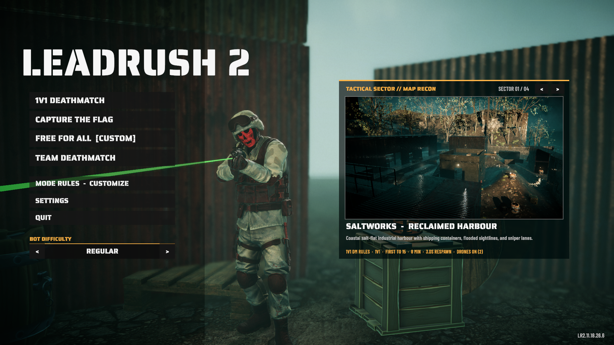

> **Built by 4 AI agents.** One developer directs; **Claude Code** (`claude-opus-5-5`), **Antigravity ("Gemini")** (`gemini-4-hydrogen` / `argon`), **GitHub Copilot** (`gpt-5.6-luna`), and **OpenAI Codex** (`gpt-6`) write the code, verify metrics, and cross-review through a shared board. The full story — with prompts, agent messages, 4-agent token/usage telemetry (`B56`), and model quality charts:
> **[How AI agents are building LeadRush 2](Docs/AI_Collaboration/README.md)** · **[How the AI agents test LeadRush 2 (QA process & pose/aim telemetry)](Docs/AI_Collaboration/QA_PROCESS.md)**.
> Project documentation: [Project history](Docs/PROJECT_HISTORY.md), [Tooling](Docs/TOOLING.md), and [P3 + HDRP 17.5 Upscaler Benchmark Report](Docs/AI_Collaboration/specs/P3_Report.md).

### By the numbers

As of build `11.19.26.6` (2026-11-19). Prompts are counted from [PROMPTS.md](Docs/AI_Collaboration/PROMPTS.md), tasks and defects
from the [ledgers](Docs/AI_Collaboration/data), board items from [AGENT_COORDINATION.md](AGENT_COORDINATION.md).

| Developer prompts | Tasks delivered | Defects logged | Board items | Commits | C# code |
|---:|---:|---:|---:|---:|---:|
| **222** | **176** | **73** | **131** | **92** | **40,320** lines in 129 files |

- **Prompts by agent:** Claude Code 119, Antigravity ("Gemini") 102, GitHub Copilot 1. The list is built from the Claude Code
  session logs and the Antigravity conversation database, so prompts given to Codex and Copilot inside their own apps are not in it.
- **Tasks by agent:** Claude 72, Gemini 53, Copilot 35, Codex 16. **Defects found by:** Gemini 27, Claude 23, Copilot 8, Codex 2
  (13 found by the developer).
- **Scope:** 4 days of development (2026-11-16 to 11-19), 4 AI agents, 4 combat maps, up to 20 bots per match in 2 to 4 teams.

What changed most recently, with screenshots: [What's new on 2026-11-19](Docs/Updates/2026-11-19.md).

### Who built what

<picture>
  <source media="(prefers-color-scheme: dark)" srcset="Docs/AI_Collaboration/figures/contribution_score_dark.png">
  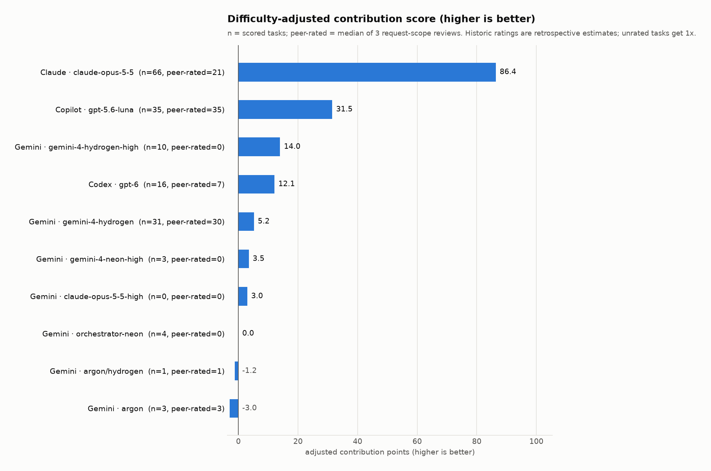
</picture>

Contribution score per agent and model, from the task and defect ledgers in `Docs/AI_Collaboration/data` (tasks delivered and
verified, bugs found in other agents' work, adopted suggestions, minus defects that reached the developer). Method, all charts
and the protocol experiments: [How AI agents are building LeadRush 2](Docs/AI_Collaboration/README.md#quality-which-model-produced-what-quality-of-work).

---

## Screenshots

In-game captures, 1920 x 1080, build 11.18.26.4 (2026-11-18).

### Gameplay Clips (`11.18.26.4`)

| Live Combat (Saltworks MK18 & Tracers) | Gunfight & Hitmarkers |
|---|---|
| 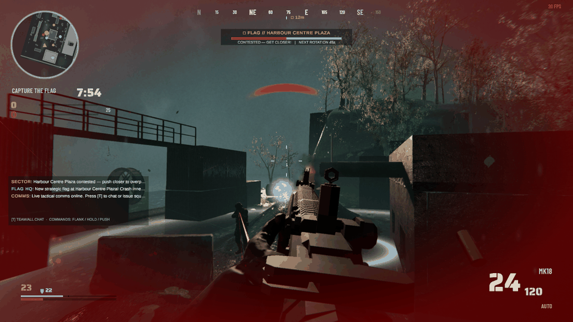 | 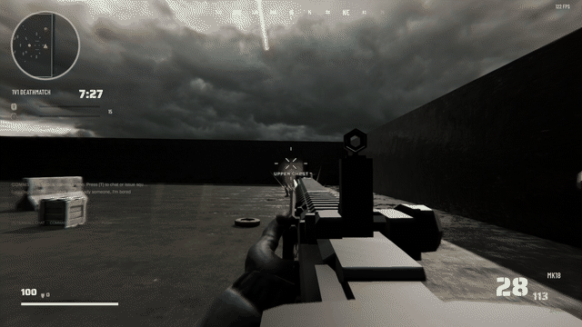 |

| Tactical & Empty Reloads | Locomotion & Sprint Transition |
|---|---|
| 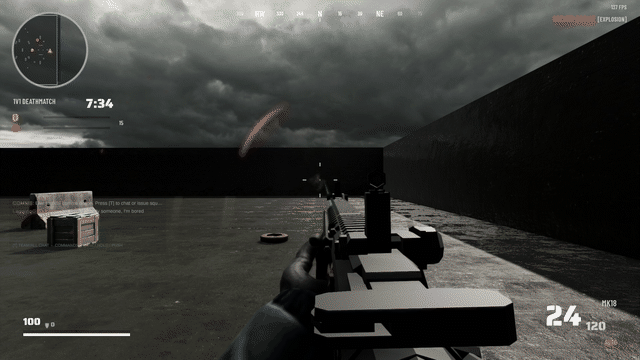 | 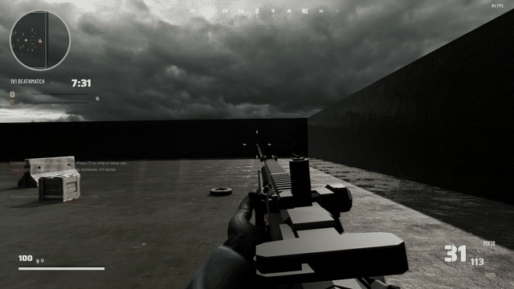 |

| Ragdoll Death & Killcam Transition |
|---|
| 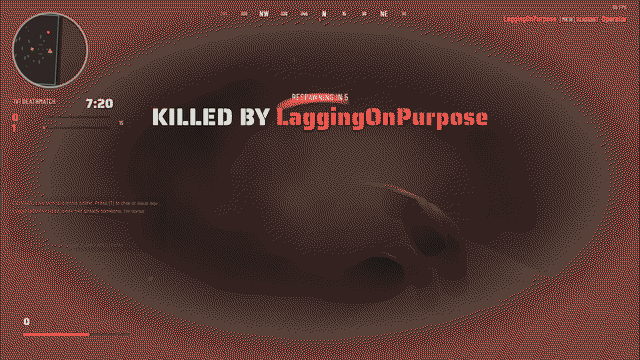 |

| Armour HUD: 100 health + 50 armour | MK18 iron sights |
|---|---|
| 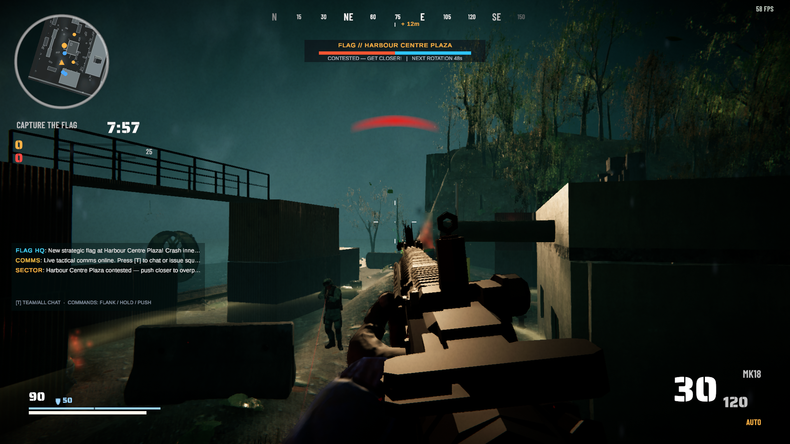 | 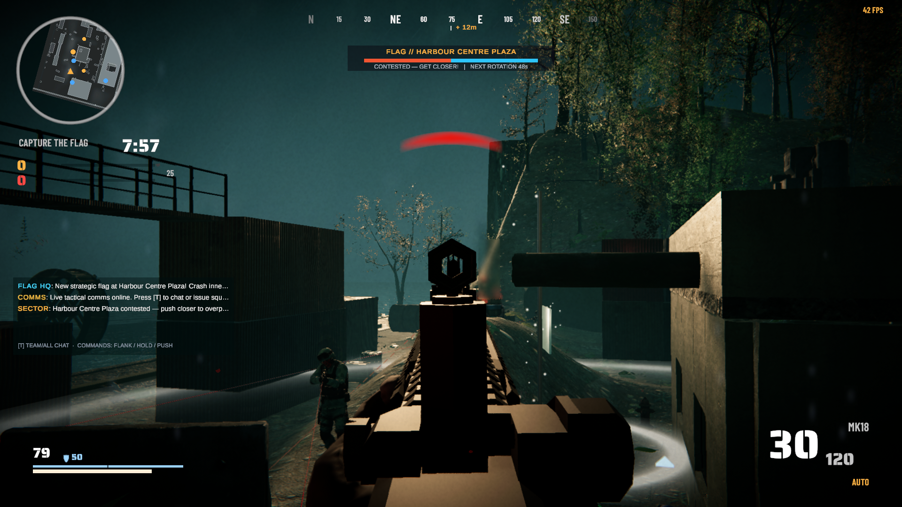 |

| Green (friendly) and red (enemy) lasers | Overheated barrel after a long spray |
|---|---|
| 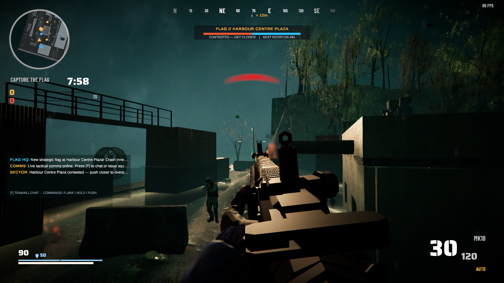 | 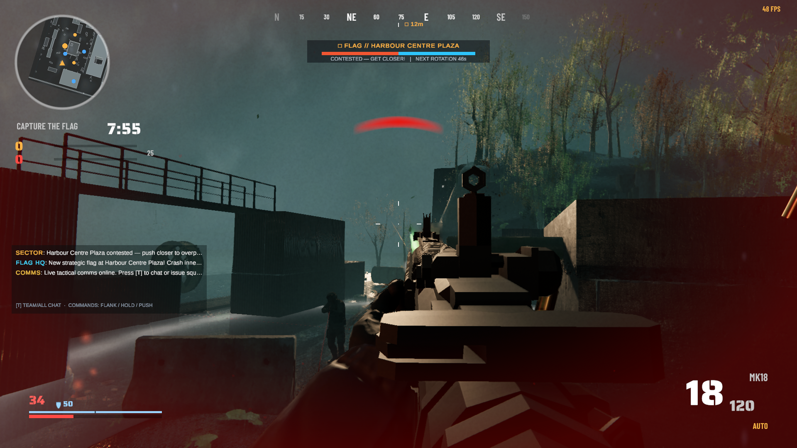 |

| Foundry: enemy by the burning trench | Saltworks: storm and fire |
|---|---|
| 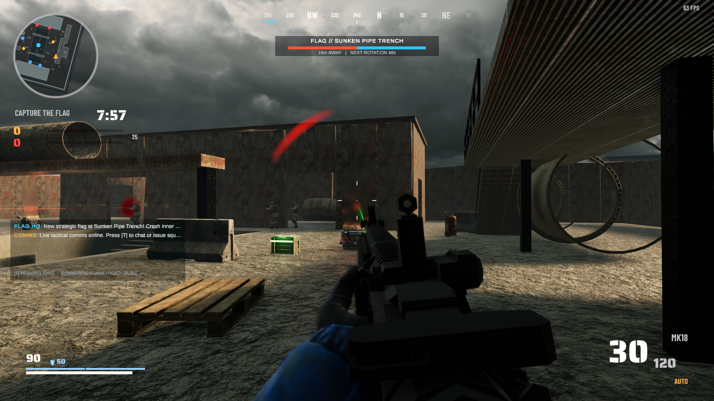 | 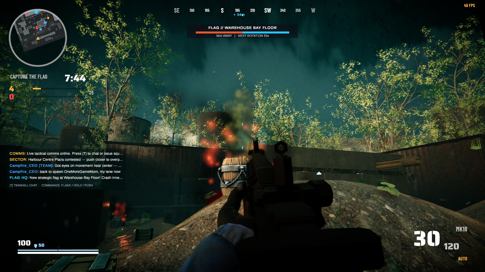 |

| Deadsector: fog in the streets | Blackline at dusk |
|---|---|
| 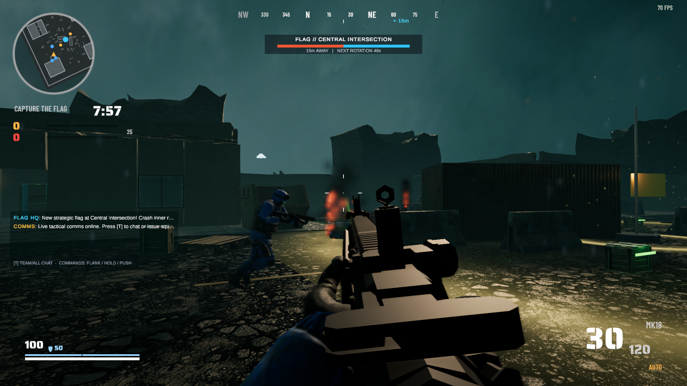 | 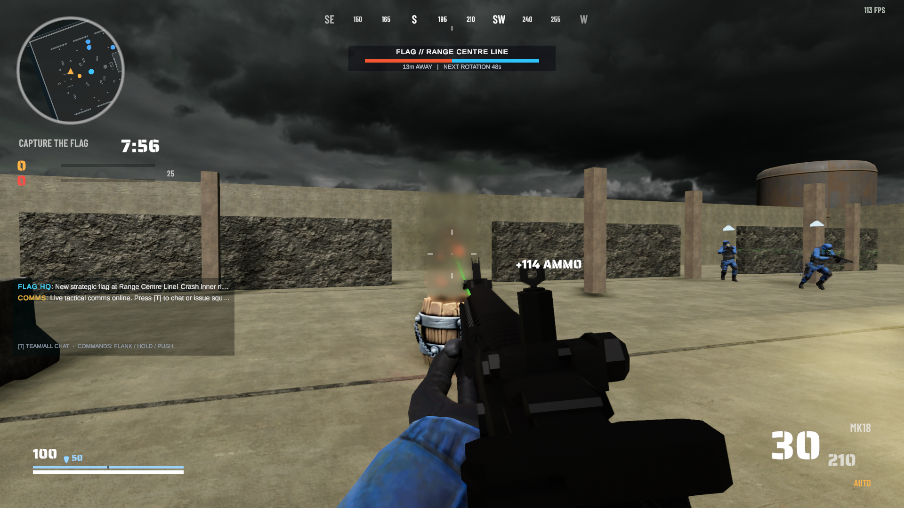 |

| Killcam: the killer's own sights | Killcam: the replay ends on your ragdoll |
|---|---|
| 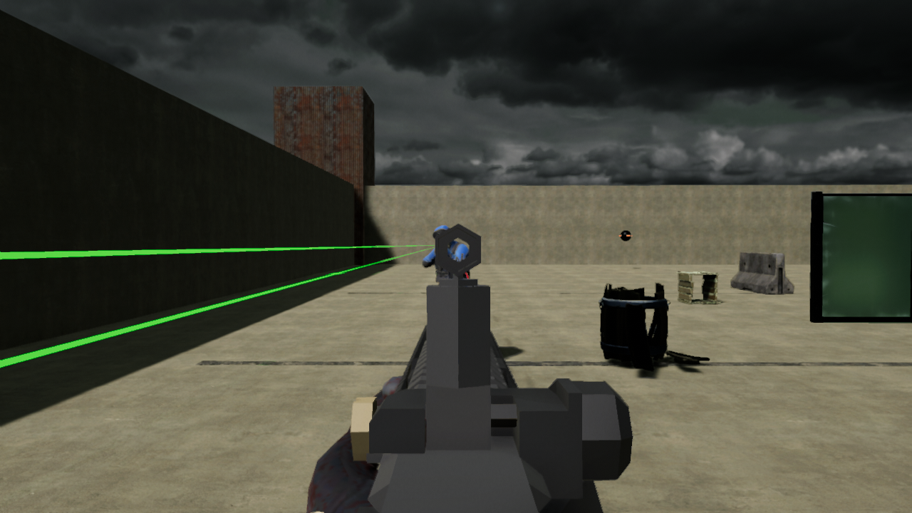 | 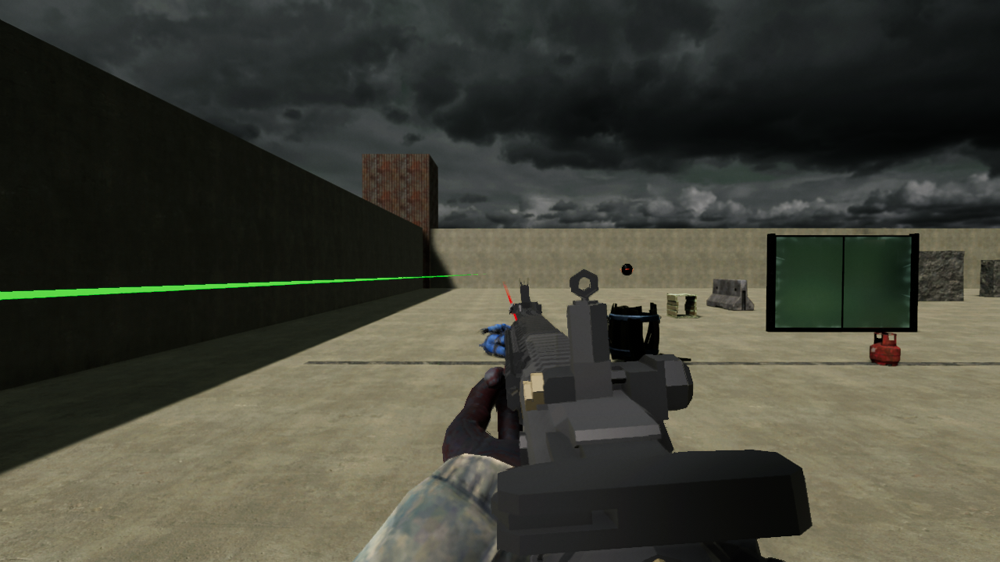 |

| Deploy screen | Settings |
|---|---|
| 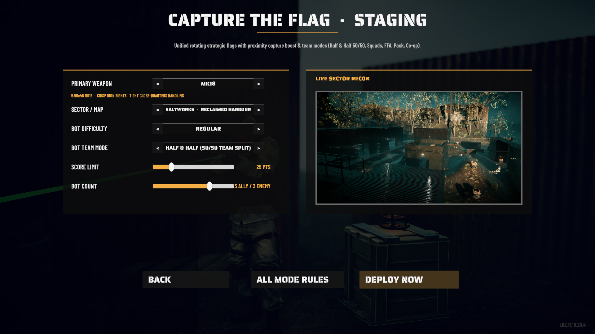 | 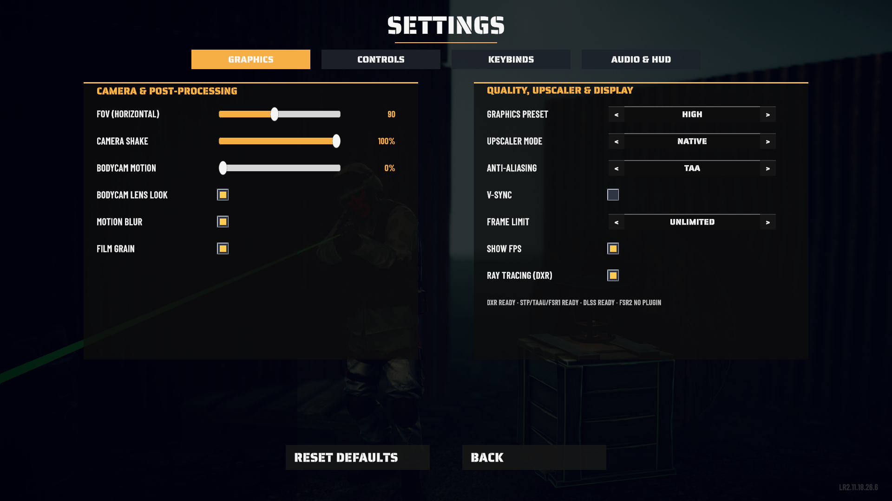 |

### How the bots behave

| Armour break and resupply | Flank a camper |
|---|---|
| 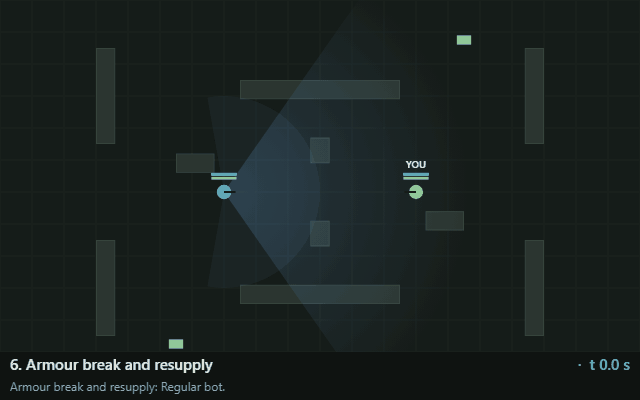 | 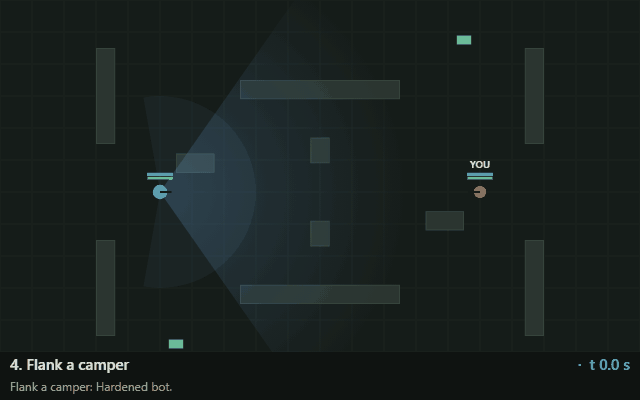 |

Eight scenarios run on a compact copy of the game's bot brain in the interactive **[LR2 Bot Lab](Docs/Bot/bot-lab.html)**
(also a [Claude artifact](https://claude.ai/artifact/Mj3oVBaf6NpdgRJSsxicPo)). Since 11-18 it also holds the former Bot Brain page, in three parts: the bot
(detection and sightlines, the priority waterfall, pathfinding, Fitts flicks and the human miss pattern, strafe tracking,
recoil, armour and resupply, presets and adaptive skill, the LLM hook), game modes (rotating CTF, chat orders) and how it
was built (agent ledgers, protocol results, research specs). All eight scenarios as GIFs:
[Bot explainer](Docs/LR2_Bot_Explainer.md#bot-lab-scenarios).

---

## Maps

| Map | Description | Preview |
|---|---|---|
| **Saltworks — Reclaimed Harbour** (`LR2_Saltworks`) | Coastal salt-flat industrial harbour with shipping containers, flooded sightlines, and sniper lanes. | 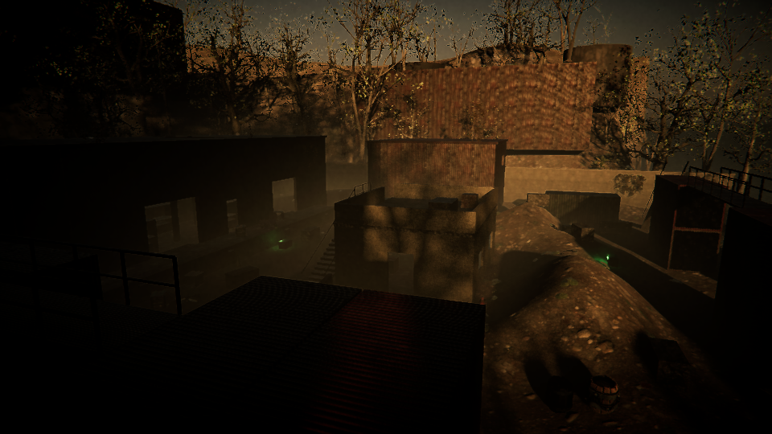 |
| **Deadsector — War-Torn City** (`LR2_Deadsector`) | Rubble-choked urban quarantine sector tuned for aggressive flanking, street fights, and interior breaches. |  |
| **Foundry — Pipe Refinery** (`LR2_Foundry`) | Multi-level chemical pipe refinery featuring steel catwalks, heavy cover, and tight chokepoints. |  |
| **Blackline — Proving Grounds** (`LR2_TestRange`) | Open tactical proving ground with clean symmetrical cover for recoil drills and bot scrimmages. |  |

---

## Features

- **Full-Body First-Person Rig (`Assets/LR2/Runtime/Characters/`):** Kinemation humanoid FPS driver (`FPSAnimator`) retargeted onto a full-body SWAT operator mesh (`RetargetProxy.cs`) with eye-locked camera alignment, leg IK foot planting, procedural weapon reload replay (`ReloadMotionBridge.cs`), wall anti-clipping (`WeaponAntiClip.cs`), standing/crouch/slide/prone/mantle stances (`SoldierMovement.cs`), and optional bodycam optics & motion (`BodycamRig.cs`). `LR2PlayablesController.cs` decides when the arms follow the body animation (sprint, prone, slide), so walking, walls and respawns keep the weapon hold; a COD-style wall tuck replaces the demo's sideways swing (11.18.26.5).
- **Weapons, Overheat & Ballistics (`Assets/LR2/Runtime/Weapons/`, `Combat/`):** The default local loadout carries the **MK18** (`5.56x45` carbine from `LeadRushHDRP` with built-in iron sights) and **MK23** suppressed sidearm (12-round mag); selectable primary rifles also keep **AK-12**, **AK-74N** (clean iron sights), and **FAL** (`LR2ContentBuilder.cs`, `LR2Session.SelectedPrimaryWeapon`). Sustained fire heats the barrel (`LR2Firearm.BarrelHeat`) causing cherry-red pipe glow, rising smoke wisps, and harsher overgassed gunfire audio; toggleable weapon lasers render **green** for player/friendly units and **red** for enemies (`WeaponLaser.cs`); tracers are **orange/yellow** for your side and **red** for enemies (`Tracer.cs`). Physical projectile ballistics (`Ballistics.cs`), range damage dropoff, penetration & destructible glass/props (`DestructibleProp.cs`), directional impact audio, and shell ejection (`ShellEjector.cs`).
- **Tactile Combat Feedback & Killcams:** 100 HP + 50 armour layer (`Health.cs` with overflow, procedural plate-shatter audio, and ammo-station refill), Battlefield-inspired hit/headshot/armour/kill markers with CoD-style vibration (`HitFeedbackHUD.cs`), dynamic `+50 HEADSHOT` / `+100 KILL` score popups & kill feed (`HUDController.cs`), Cobalt-Navy SWAT vs Desert-Crimson Marauder faction uniforms & masks (`SoldierVisuals.cs`), 3D blood droplets that trickle across weapon meshes (`GunBloodFX.cs`), directional damage arcs, and eye-socket first-person killer-perspective killcam replays (`KillcamDirector.cs`).
- **Game Modes & Persistent Custom Rules (`Assets/LR2/Runtime/Game/`):** **Duel (1v1)**, **Free For All**, **Team Deathmatch**, and **Rotating Capture the Flag** (`FlagZoneController.cs` BF6-inspired proximity-weighted capture speed across 5 `BotTeamAlignment` modes including **Half & Half 50/50 split**, Squads, FFA, Pack, and Co-op) plus live **Tactical Bot Chat** (`[T]` keyword directives & delayed banter in `TacticalChatSystem.cs`). Horizontal FOV slider (`65–120`), Master/Effects/Music/UI audio sliders, `< VALUE >` stepper controls for graphics quality, **HDRP 17.5 multi-upscaler backend (`NATIVE`, `STP`, `TAAU`, `FSR 1.0`, `DLSS`, `FSR 2` in `UpscalerBackend.cs`)**, anti-aliasing (`None`, `FXAA`, `SMAA`, `TAA`), frame rate limit, bot difficulty, live keybind rebinding (`LR2Bindings.cs` -> `PlayerInputSource.cs`), and FPS counter persist via `PlayerPrefs` (`LR2Settings.cs`, `SettingsPanel.cs`, `MainMenuController.cs`).
- **Four-Map Optimization & Automated Telemetry (`Assets/LR2/Runtime/World/PerformanceFrameTelemetry.cs`, `specs/P3_Report.md`):** Quality-aware shadow tiers, camera-distance light culling (`fadeDistance`/`shadowFadeDistance`), single-light burning barrels, time-sliced arena reflection probes, throttled `WeatherSystem` & `FoliageSway`, and spawn-to-spawn cover safety across all four maps bring steady 1080p frame times to `6.8–9.6 ms` avg (`15.7–19.1 ms` p99, `0` QA failures across all 5 scenes).
- **War-Torn Procedural Arenas (`Assets/LR2/Editor/LR2MapBuilder*.cs`, `Assets/LR2/Meshes/Procedural/`):** Leartes/ScansFactory pack props preserving tactical cover heights (`B75`), tileable `_DetailMap` wear, HDRP `SSAO` + `ContactShadows`, per-map `ShadowsMidtonesHighlights` colour grading, ground-level `AtmosphereFX` fog, `FireHazard` burning barrels (`heat haze`), destructible thin-refraction `M_LR2_Glass_*` panes (`B30`), and tuned HDRP lighting across all four combat maps (`B1`/`B72`).
- **Skirmish Lobby & AI vs AI (`Assets/LR2/Runtime/UI/SkirmishLobby.cs`, `Game/SkirmishSetup.cs`, `Game/SpectatorCamera.cs`):** The main menu is a single **PLAY**. It opens a Command & Conquer style lobby: up to 20 bots in a scrolling roster, each with its own difficulty (Recruit to Veteran, or Adaptive) and team (free for all, Alpha, Bravo, Charlie, Delta) for 2, 3 and 4-way games, plus presets, mode, map, limits and weapon. **AI vs AI** leaves you out of the match: a spectator camera (chase, eye view, free fly, auto director) follows the bots while an AI test bench tallies kills, deaths and K/D per difficulty. The menu background cuts to a matching slow-motion shot for each screen (`World/MenuCinematic.cs`).
- **Tactical Bot AI (`Assets/LR2/Runtime/AI/`):** Staggered line-of-sight & noise perception (`BotPerception.cs`), 4 Hz utility brain with cover retreat, disengaged-only `AmmoCrate` ammo/armour resupply (`B74b`), stealth/flank goals, hunting & squad following (`TacticalBotBrain.cs`), NavMesh locomotion with unstuck mantling, Fitts/ESTA/CSKnow/Aim Lab biomechanical aiming (`BotController.cs`), per-preset detection speed and composure with Hardened/Veteran bots pressing a reloading or hurt target ([explainer 4b](Docs/LR2_Bot_Explainer.md)), Adaptive difficulty (`AdaptiveDifficultyTracker.cs`), and external LLM/commander hooks (`IBotDirectiveProvider`). Explore the **[LR2 Bot Lab](Docs/Bot/bot-lab.html)** (eight live scenarios, also a [Claude artifact](https://claude.ai/artifact/Mj3oVBaf6NpdgRJSsxicPo)), the **[Bot explainer with animated GIFs](Docs/LR2_Bot_Explainer.md)**, or the [3-tab manual](Docs/Bot/bot-brain.html).

---

## Controls

| Keyboard / Mouse | Gamepad | Action |
|---|---|---|
| `W` `A` `S` `D` | Left Stick | Move |
| `Mouse` | Right Stick | Look / Aim |
| `Left Click` | `RT` | Fire |
| `Right Click` | `LT` | Aim Down Sights (ADS) |
| `R` | `X` (West) | Reload |
| `Left Shift` | `L3` | Sprint |
| `Space` | `A` (South) | Jump / Mantle / Stand Up |
| `C` / `Left Ctrl` | `B` (East) | Crouch (Slide while sprinting) |
| `Z` | `D-Pad Down` | Toggle Prone |
| `Q` / `E` | — | Lean Left / Right |
| `1` / `2` / `Scroll` | `Y` (North) | Switch Weapon (Primary / Sidearm) |
| `F` | — | Interact (Ammo Crates) |
| `Tab` | — | Scoreboard |
| `Esc` | — | Pause / Back |

---

## Opening & Building in Unity

> **Note on Third-Party Assets:** This public repository excludes paid Unity Asset Store packs and non-redistributable local audio (see **[THIRD_PARTY_ASSETS.md](THIRD_PARTY_ASSETS.md)** and `.gitignore`).

1. Open the project in **Unity `6000.5.0f1` (HDRP)**.
2. Import the required Asset Store packages listed in [THIRD_PARTY_ASSETS.md](THIRD_PARTY_ASSETS.md) into their expected `Assets/` folders so GUID references resolve.
3. Run **LR2 > Build Everything** (`LR2BuildPipeline.BuildAllBatch`) to generate derived textures/masks (woodland/desert uniform dyes, skull mask textures, packed HDRP masks), weapons, character prefabs, UI prefabs, NavMeshes, minimaps, and all 5 scenes (`LR2_MainMenu`, `LR2_Saltworks`, `LR2_Deadsector`, `LR2_Foundry`, `LR2_TestRange`).
4. Open `Assets/LR2/Scenes/LR2_MainMenu.unity` and press **Play**.

---

## Project Structure

```text
Assets/LR2/
├── Data/           # Weapon definitions, audio profiles, bot difficulties, HDRP profiles, UI presets
├── Editor/         # Procedural content, UI, map, NavMesh, preview capture, and smoke-test builders
├── FX/             # Blood/decal/shell/tracer materials and prefabs
├── Materials/      # Character, weapon, and environment materials
├── Meshes/         # Procedurally deformed war-torn containers, walls, masonry, and rubble (.asset)
├── Prefabs/        # Operator/bot prefabs, weapon prefabs, UI prefabs
├── Resources/LR2/  # Runtime-loaded MapPreviews sprites and themes
├── Runtime/
│   ├── AI/         # BotPerception, TacticalBotBrain, BotController, SeekerDrone, BotTypes
│   ├── Audio/      # LR2Audio spatial/layered mixer & ambush/reverb ambience
│   ├── Characters/ # SoldierController, SoldierMovement, RetargetProxy, ReloadMotionBridge, BodycamRig
│   ├── Combat/     # Ballistics, Hitbox, Health, DestructibleProp
│   ├── Core/       # GameEvents, LR2Settings, LR2Layers
│   ├── FX/         # GunBloodFX, MuzzleFlash, Tracer, ShellEjector
│   ├── Game/       # MatchManager, MatchSettings (LR2Session), GameModeRules
│   ├── UI/         # MainMenuController, SettingsPanel, HUDController, HitFeedbackHUD, CombatPostFX
│   ├── Weapons/    # LR2Firearm, WeaponDefinition, LR2Item
│   └── World/      # KillcamDirector, WeatherSystem, LightFlicker, FoliageSway, PlaytestRobot
└── Scenes/         # LR2_MainMenu + Saltworks, Deadsector, Foundry, TestRange + baked NavMeshes
Docs/
├── AI_Collaboration/  # How the AI agents build the game: story, prompts, protocol, research log
├── Media/             # README screenshots
└── LR2_Bot_Explainer.md
```
