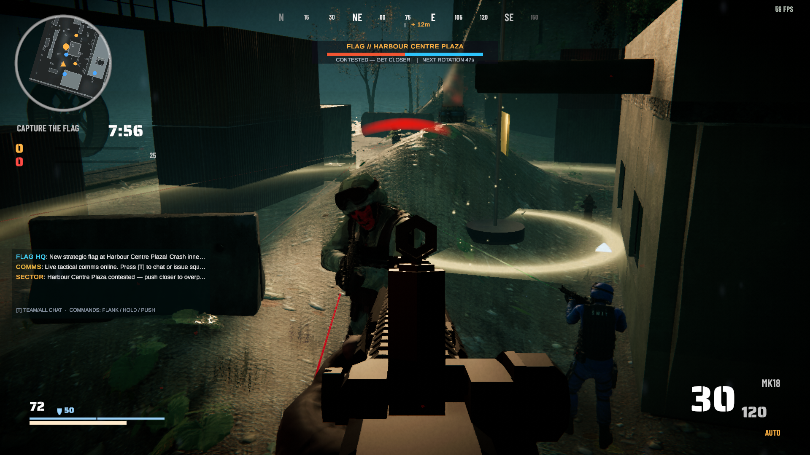
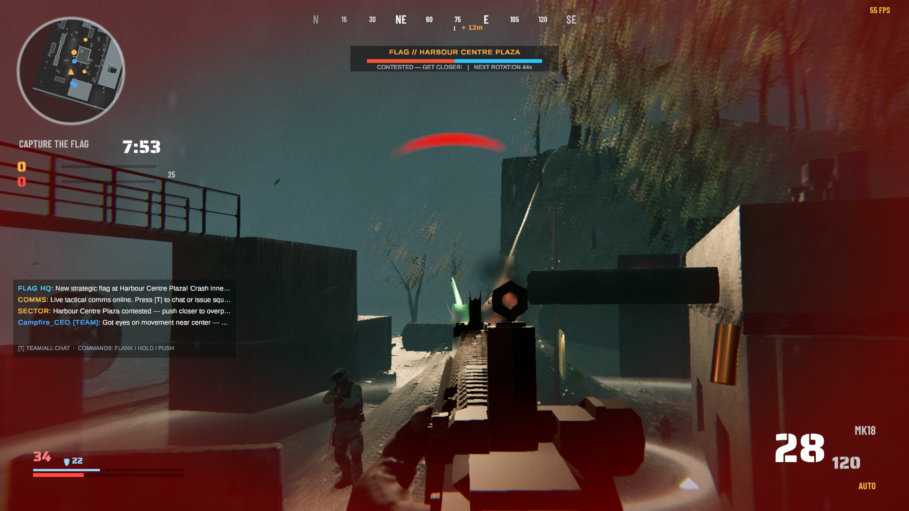
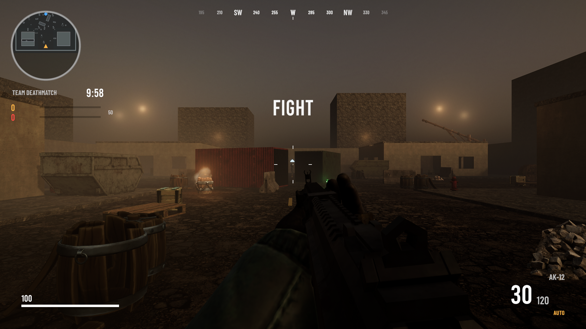
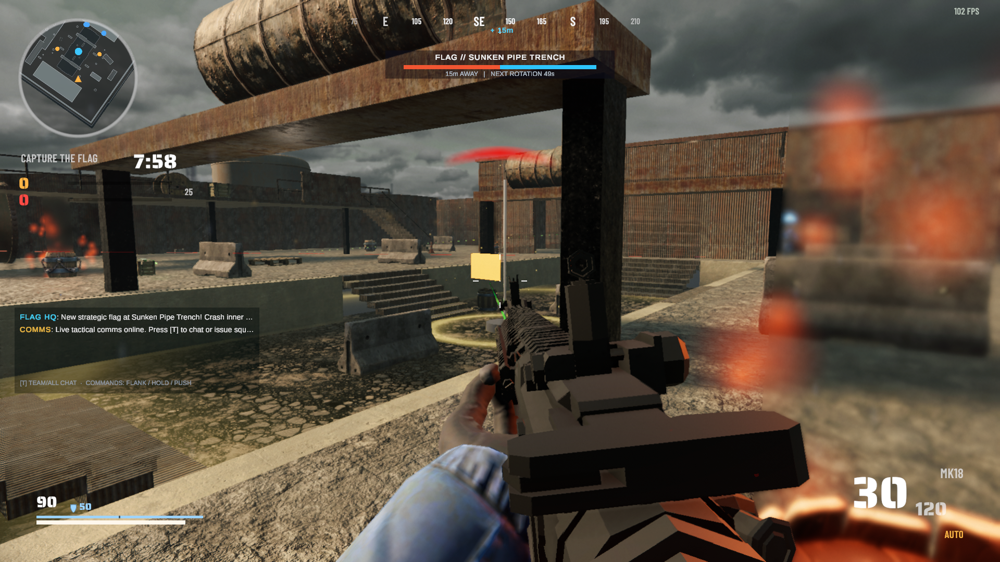
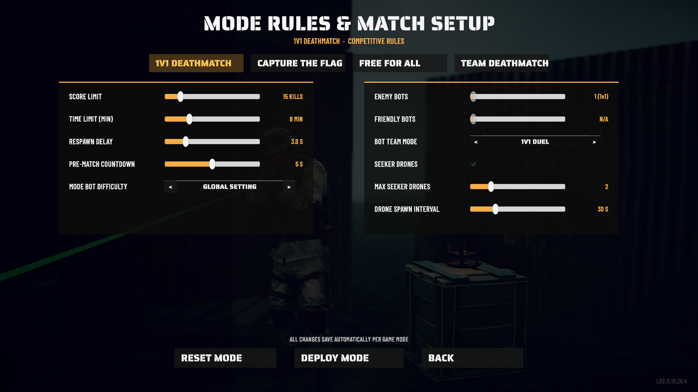
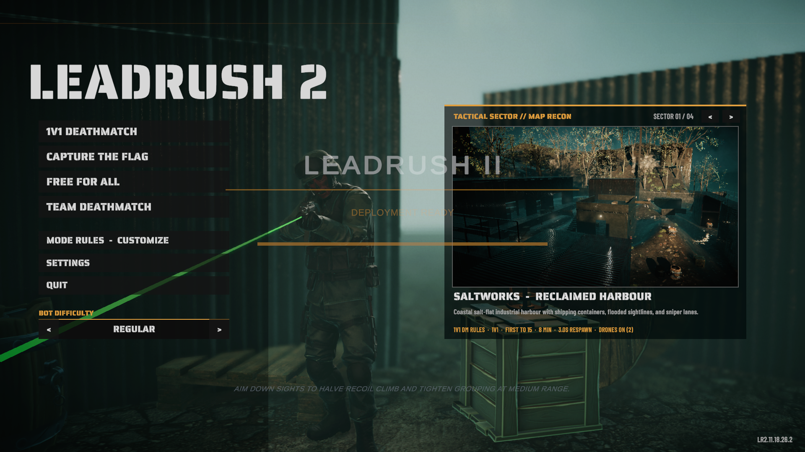
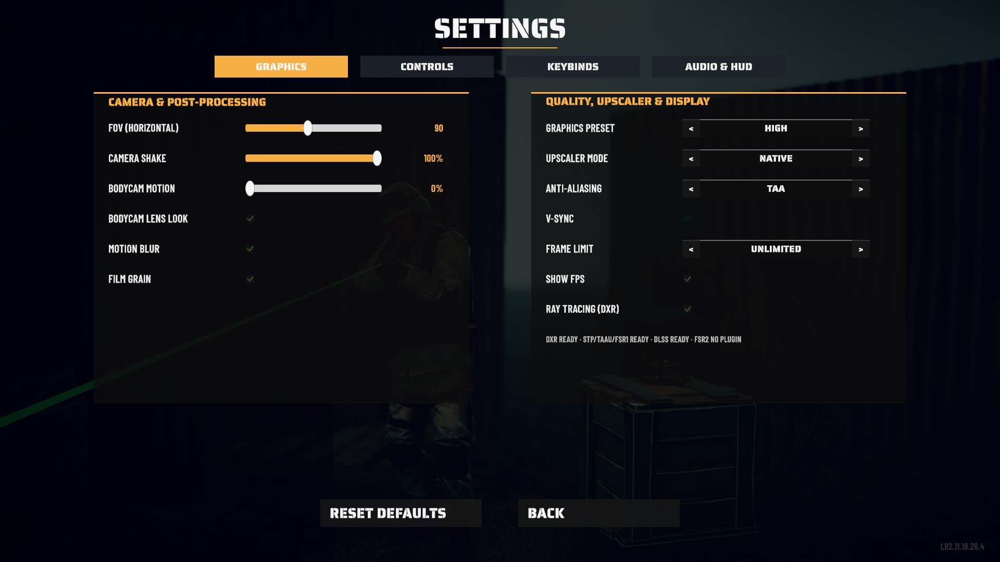
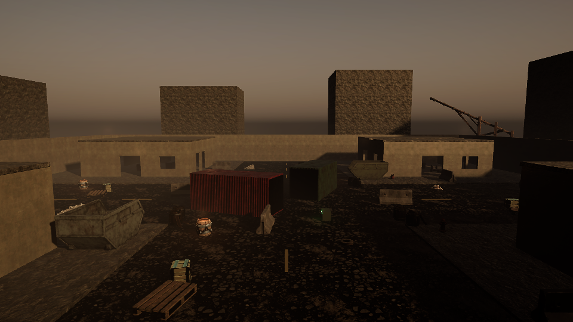
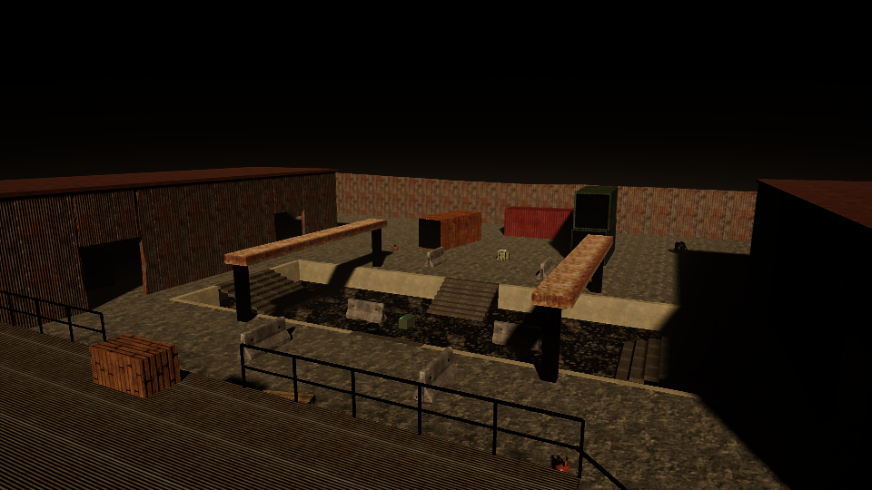
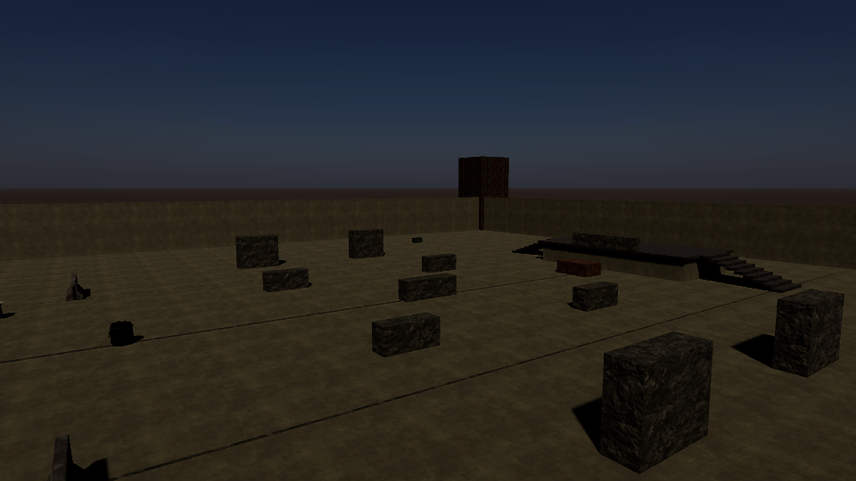

# LeadRush 2

Tactical first-person shooter built in **Unity 6 (`6000.5.0f1`) HDRP** ([github.com/Tokey/Lead-Rush-2](https://github.com/Tokey/Lead-Rush-2)).

LeadRush 2 pairs full-body procedural first-person weapon & locomotion animation with multi-layered HDRP lighting, utility-driven AI bots and seeker drones, custom per-mode match rules, persistent camera/audio settings, and first-person killcam replays across four combat maps.



> **Built by AI agents.** One developer directs; Claude Code, an Antigravity agent and GitHub Copilot write the code, test the game
> and review each other through a shared board. The full story, with every prompt, the agents' messages and a quality chart:
> **[How AI agents are building LeadRush 2](Docs/AI_Collaboration/README.md)**.
> Project documentation: [Project history](Docs/PROJECT_HISTORY.md) and [Tooling](Docs/TOOLING.md).

---

## Screenshots

| Combat HUD, Hit Feedback & Blood FX | Urban Combat — Deadsector |
|---|---|
|  |  |

| Pipe Refinery — Foundry | Custom Match Rules Setup |
|---|---|
|  |  |

| Main Menu | Settings Steppers (No Dropdowns) |
|---|---|
|  |  |

---

## Maps

| Map | Description | Preview |
|---|---|---|
| **Saltworks — Reclaimed Harbour** (`LR2_Saltworks`) | Coastal salt-flat industrial harbour with shipping containers, flooded sightlines, and sniper lanes. |  |
| **Deadsector — War-Torn City** (`LR2_Deadsector`) | Rubble-choked urban quarantine sector tuned for aggressive flanking, street fights, and interior breaches. |  |
| **Foundry — Pipe Refinery** (`LR2_Foundry`) | Multi-level chemical pipe refinery featuring steel catwalks, heavy cover, and tight chokepoints. |  |
| **Test Range — Bot Arena** (`LR2_TestRange`) | Open tactical proving ground with clean symmetrical cover for recoil drills and bot scrimmages. |  |

---

## Features

- **Full-Body First-Person Rig (`Assets/LR2/Runtime/Characters/`):** Kinemation humanoid FPS driver (`FPSAnimator`) retargeted onto a full-body SWAT operator mesh (`RetargetProxy.cs`) with eye-locked camera alignment, leg IK foot planting, procedural weapon reload replay (`ReloadMotionBridge.cs`), wall anti-clipping (`WeaponAntiClip.cs`), standing/crouch/slide/prone/mantle stances (`SoldierMovement.cs`), and optional bodycam optics & motion (`BodycamRig.cs`).
- **Weapons & Ballistics (`Assets/LR2/Runtime/Weapons/`, `Combat/`):** Active loadout carries the **AK-12** primary rifle (30-round mag, auto/semi, crisp iron-sight ADS) and **MK23** suppressed sidearm (12-round mag), with additional built weapon prefabs for **AK-74N**, **MK18**, and **FAL** (`LR2ContentBuilder.cs`). Physical projectile ballistics (`Ballistics.cs`), range damage dropoff, penetration & destructible glass/props (`DestructibleProp.cs`), directional impact audio, and shell ejection (`ShellEjector.cs`).
- **Tactile Combat Feedback & Killcams:** Battlefield-inspired hit/headshot/kill markers and skull badge (`HitFeedbackHUD.cs`), dynamic `+50 HEADSHOT` / `+100 KILL` score popups & kill feed (`HUDController.cs`), 3D blood droplets that trickle across weapon meshes and camera lens (`GunBloodFX.cs`), directional damage arcs, and first-person killer-perspective killcam replays (`KillcamDirector.cs`).
- **Game Modes & Persistent Custom Rules (`Assets/LR2/Runtime/Game/`):** **Duel (1v1)**, **Free For All**, and **Team Deathmatch** with per-mode persistent customization (`Score Limit`, `Time Limit`, `Respawn Delay`, `Countdown`, `Enemy/Friendly Bots`, `Seeker Drones`, and per-mode `Bot Difficulty`). Horizontal FOV slider (`65–120`), Master/Effects/Music/UI audio sliders, `< VALUE >` stepper controls for graphics quality, frame rate limit, and bot difficulty, plus FPS counter all persist via `PlayerPrefs` (`LR2Settings.cs`, `SettingsPanel.cs`, `MainMenuController.cs`).
- **War-Torn Procedural Arenas (`Assets/LR2/Editor/LR2MapBuilder*.cs`, `Assets/LR2/Meshes/Procedural/`):** Dented/warped corrugated containers, jagged broken masonry parapets and ruined skyline silhouettes, exposed rusty rebar, scattered rubble, destructible glass panels in steel frames, and tuned HDRP volumetric lighting across all four combat maps.
- **Tactical Bot AI (`Assets/LR2/Runtime/AI/`):** Staggered line-of-sight & noise perception (`BotPerception.cs`), 4 Hz utility brain with cover retreat, stealth/flank goals, hunting & squad following (`TacticalBotBrain.cs`), NavMesh locomotion with unstuck mantling and critically-damped aim springs across 4 difficulty presets (`Recruit`, `Regular`, `Hardened`, `Veteran`), plus LLM/external commander hooks (`IBotDirectiveProvider`, `IBotBrain`). See **[Docs/LR2_Bot_Explainer.md](Docs/LR2_Bot_Explainer.md)** for full details.

---

## Controls

| Keyboard / Mouse | Gamepad | Action |
|---|---|---|
| `W` `A` `S` `D` | Left Stick | Move |
| `Mouse` | Right Stick | Look / Aim |
| `Left Click` | `RT` | Fire |
| `Right Click` | `LT` | Aim Down Sights (ADS) |
| `R` | `X` (West) | Reload |
| `Left Shift` | `L3` | Sprint |
| `Space` | `A` (South) | Jump / Mantle / Stand Up |
| `C` / `Left Ctrl` | `B` (East) | Crouch (Slide while sprinting) |
| `Z` | `D-Pad Down` | Toggle Prone |
| `Q` / `E` | — | Lean Left / Right |
| `1` / `2` / `Scroll` | `Y` (North) | Switch Weapon (Primary / Sidearm) |
| `F` | — | Interact (Ammo Crates) |
| `Tab` | — | Scoreboard |
| `Esc` | — | Pause / Back |

---

## Opening & Building in Unity

> **Note on Third-Party Assets:** This public repository excludes paid Unity Asset Store packs and non-redistributable local audio (see **[THIRD_PARTY_ASSETS.md](THIRD_PARTY_ASSETS.md)** and `.gitignore`).

1. Open the project in **Unity `6000.5.0f1` (HDRP)**.
2. Import the required Asset Store packages listed in [THIRD_PARTY_ASSETS.md](THIRD_PARTY_ASSETS.md) into their expected `Assets/` folders so GUID references resolve.
3. Run **LR2 > Build Everything** (`LR2BuildPipeline.BuildAllBatch`) to generate derived textures/masks (woodland/desert uniform dyes, skull mask textures, packed HDRP masks), weapons, character prefabs, UI prefabs, NavMeshes, minimaps, and all 5 scenes (`LR2_MainMenu`, `LR2_Saltworks`, `LR2_Deadsector`, `LR2_Foundry`, `LR2_TestRange`).
4. Open `Assets/LR2/Scenes/LR2_MainMenu.unity` and press **Play**.

---

## Project Structure

```text
Assets/LR2/
├── Data/           # Weapon definitions, audio profiles, bot difficulties, HDRP profiles, UI presets
├── Editor/         # Procedural content, UI, map, NavMesh, preview capture, and smoke-test builders
├── FX/             # Blood/decal/shell/tracer materials and prefabs
├── Materials/      # Character, weapon, and environment materials
├── Meshes/         # Procedurally deformed war-torn containers, walls, masonry, and rubble (.asset)
├── Prefabs/        # Operator/bot prefabs, weapon prefabs, UI prefabs
├── Resources/LR2/  # Runtime-loaded MapPreviews sprites and themes
├── Runtime/
│   ├── AI/         # BotPerception, TacticalBotBrain, BotController, SeekerDrone, BotTypes
│   ├── Audio/      # LR2Audio spatial/layered mixer & ambush/reverb ambience
│   ├── Characters/ # SoldierController, SoldierMovement, RetargetProxy, ReloadMotionBridge, BodycamRig
│   ├── Combat/     # Ballistics, Hitbox, Health, DestructibleProp
│   ├── Core/       # GameEvents, LR2Settings, LR2Layers
│   ├── FX/         # GunBloodFX, MuzzleFlash, Tracer, ShellEjector
│   ├── Game/       # MatchManager, MatchSettings (LR2Session), GameModeRules
│   ├── UI/         # MainMenuController, SettingsPanel, HUDController, HitFeedbackHUD, CombatPostFX
│   ├── Weapons/    # LR2Firearm, WeaponDefinition, LR2Item
│   └── World/      # KillcamDirector, WeatherSystem, LightFlicker, FoliageSway, PlaytestRobot
└── Scenes/         # LR2_MainMenu + Saltworks, Deadsector, Foundry, TestRange + baked NavMeshes
Docs/
├── AI_Collaboration/  # How the AI agents build the game: story, prompts, protocol, research log
├── Media/             # README screenshots
└── LR2_Bot_Explainer.md
```
